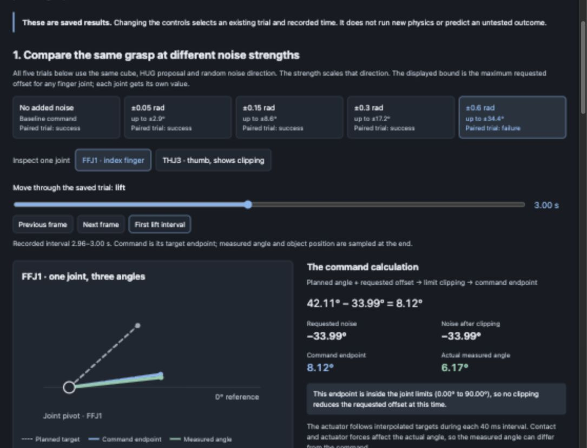

# Grasp Failure Prediction and Recovery

MuJoCo research infrastructure for executing dexterous grasps and studying
whether their outcomes can be predicted early enough for useful intervention.

## Interactive noise demo

[](docs/demos/grasp-noise/index.html)

The [complete demo website](docs/demos/grasp-noise/index.html) lets you select
five recorded noise strengths, inspect joint limit clipping and measured finger
motion, and watch successful and failed replays. It embeds the historical
50 attempt cube pilot and works offline. It is an explanation of recorded
simulation data, rather than a live simulation or prediction model.

```bash
python3 -m http.server 8767 --bind 127.0.0.1 --directory docs/demos/grasp-noise
```

Open [the local demo](http://127.0.0.1:8767/) while the server is running. See the
[demo guide](docs/demos/grasp-noise/README.md) and
[Step 1 walkthrough](docs/HUG_STEP_1_WALKTHROUGH.md) for provenance and labels.

This project studies one connected question:

> How can a robot learn to grasp an object, recognize when its current behavior
> is likely to fail, and choose an effective recovery while recovery is still
> possible?

The work progresses from **learning actions**, to **predicting outcomes**, to
**choosing interventions**. These are separately trained and evaluated learning
problems that share the same robot, task, objects, logging infrastructure, and
controlled physical variations.

This is one research program, not a commitment to produce three papers. The
initial goal is one coherent, reproducible result. A component should become a
separate paper only if it develops an independent question, contribution, and
body of evidence.

## Completed work and working paper

The [partner handoff](docs/PARTNER_HANDOFF.md) confirms the completed work,
identifies the latest branch and data locations, and gives the next experiment
in order.

The [research decision history](docs/RESEARCH_DECISIONS.md) explains how evidence
changed our plan, which choices are implemented, and which questions remain
proposed. It connects the original pilot, unfamiliar object evaluation, mug
collision correction and consideration of public data and existing detectors.

The [working paper draft](docs/paper/working_draft.tex) and
[six-step evidence and literature notes](docs/PAPER_PROGRESS.md) describe the
completed pilot and the decisions behind it. The paper is an editable research
draft; future-slip prediction, recovery, and physical transfer remain research
goals.

1. **Review inputs and assets:** selected HUG development assets and documented
   geometry, licensing, camera, and retargeting requirements.
2. **Run varied trials:** executed fresh HUG proposals with a fixed actuated
   Shadow controller and logged bounded finger-target noise.
3. **Save trajectories:** collected 1,040 attempts across two geometries and
   four observation families: 444 successes, 596 failures, and zero runtime errors.
4. **Audit task labels:** retained the frozen 14 cm lift/2 s hold task definition,
   with explicit cutoff and failure-category limitations.
5. **Freeze grouped splits:** exported a portable pre-lift dataset with 520
   training, 260 validation and 260 test attempts, grouped by observation family.
   See [the split contract](docs/DATA_SPLITS.md) for the retrospective pilot limits.
6. **Train a causal baseline:** trained and evaluated a first task-outcome
   model using encoder and command history before lifting. See
   [the model explanation and results](docs/PREDICTION_BASELINE.md).

The code is published in reviewable sections: [interactive noise demo (#8)](https://github.com/nilakarthikesan/grasp-failure-recovery/pull/8),
[literature notes (#9)](https://github.com/nilakarthikesan/grasp-failure-recovery/pull/9),
[partner execution follow-up (#12)](https://github.com/nilakarthikesan/grasp-failure-recovery/pull/12),
[noisy collector (#10)](https://github.com/nilakarthikesan/grasp-failure-recovery/pull/10),
[verified multi-scene collection (#11)](https://github.com/nilakarthikesan/grasp-failure-recovery/pull/11),
[paper and evidence notes (#13)](https://github.com/nilakarthikesan/grasp-failure-recovery/pull/13),
[grouped prefix dataset (#14)](https://github.com/nilakarthikesan/grasp-failure-recovery/pull/14),
and [trained task-outcome baseline (#15)](https://github.com/nilakarthikesan/grasp-failure-recovery/pull/15).
The [collection guide](docs/MULTI_SCENE_COLLECTION.md) includes the local viewer,
six replay examples, exact settings, data paths, and verification evidence.
The [published closing histories](research_artifacts/object_scene_pilot_v1/)
support reproducing training without downloading HUG assets or raw simulator states.
The [trained baselines](research_artifacts/task_outcome_baseline_v1/) include
coefficients, selection settings and all predictions. On the reserved apple
scene, the state-and-command model has failure-ranking AUC 0.8523, compared
with 0.6419 for commands alone. This is a retrospective development result
from one test observation family; the paper explains the limits and errors.

The subsequent [frozen model test on fresh objects and scenes](docs/FRESH_OBJECT_EVALUATION.md)
collected **2,080 new attempts**: 659 successes, 1,421 failures and zero errors.
The original model, normalization, controller, scorer and threshold stayed
unchanged. Its failure ranking AUC is **0.9173 on fresh cube/apple scenes** and
**0.5588 across new milk carton/mug attempts**. The new objects expose substantial
false alarms and missed failures; all mug attempts fail, so a mug success false
alarm rate cannot be estimated. The [portable evaluation bundle](research_artifacts/fresh_object_scene_eval_v1/)
contains inputs, predictions and provenance. The [local walkthrough viewer](http://127.0.0.1:8770/)
shows eight replays beside their saved predictions while the server is running.

The [mug collision diagnosis and fix](docs/MUG_TABLE_CLEARANCE.md) explains why
the original mug grasps struck the table: the Shadow forearm did not fit the
human-hand pose. A new execution protocol adjusts the wrist while preserving
the intended grasp and checks actual table clearance at every physics step.
Its small regression completed 26 trials with zero table contacts and stopped
one high-noise closure before contact. See the [before/after demo](research_artifacts/mug_table_clearance_v1/mug_before_after.mp4)
and [local replay viewer](http://127.0.0.1:8771/). Larger collection remains the
next step; these controller checks do not replace the original model evaluation.

---

## Research program

### Part I — Execute HUG grasps with a dexterous hand

Given an RGB-D observation and a selected object, use HUG to generate multiple
MANO human-hand grasp samples. Retarget each sample to an articulated dexterous
hand with [Dex Retargeting](https://github.com/dexsuite/dex-retargeting),
execute the grasp in MuJoCo, then lift and transport the object under controlled
conditions.

The initial executable embodiment is the Adroit/Shadow Hand in MuJoCo. The
repository's Panda parallel-jaw pipeline remains useful generic manipulation
infrastructure, but it cannot execute a MANO dexterous grasp and is not the
primary experimental embodiment. A Panda or another arm may later carry a
dexterous hand.

**Deliverable:** a reproducible RGB-D → HUG → Dex Retargeting → Shadow Hand →
grasp/lift/transport pipeline with saved successful and failed executions.

The corrected HUG-centered scope is in
[`docs/RESEARCH_FOUNDATIONS.md`](docs/RESEARCH_FOUNDATIONS.md); the executable
Part I contract will be frozen after the retargeting prototype is validated.

### Part II — Anticipate future failure

Freeze the HUG-conditioned grasp execution system and run it across controlled
grasp, object, and motion conditions. Train a separate temporal model to estimate:

> Given the observations and actions so far, how likely is the object to be
> lost within a future horizon if the robot continues its current behavior?

The predictor is conditioned on behavior because the same grasp may survive a
slow movement and fail under a more aggressive motion. Data is split by complete
episodes, objects, and physical conditions—not neighboring frames.

**Deliverable:** a calibrated future-failure predictor with measured warning
lead time and evaluation under held-out HUG grasp samples, objects, masses, and
motion conditions.

### Part III — Estimate recoverability and intervene

At selected simulator states, compare multiple possible interventions from
matched starting conditions. Initially, the actions are fixed, bounded recovery
behaviors such as:

- adjust grip within hardware limits;
- slow or modify the transport motion;
- return the object to a support surface and regrasp; or
- continue the nominal policy.

Train an intervention-outcome model to estimate which available behavior is
most likely to recover successfully after realistic response delay. A learned
recovery controller comes only after this comparison is understood.

**Deliverable:** an evaluated recovery selector/controller, measurements of
when recovery remains possible, and explicit separation between task
completion, object-preserving aborts, and harmful interventions.

---

## End-to-end architecture

```
RGB-D object observation
    │
    ▼
HUG: generate MANO human-hand grasp samples
    │
    ▼
Part I: Dex Retargeting → Shadow Hand → grasp/lift/transport
    │
    ├── successful and failed executions under controlled physics
    ▼
Part II: train future-failure predictor
    │
    ├── warning states + matched simulator intervention trials
    ▼
Part III: train intervention-outcome model and recovery selector
    │
    ▼
compare base, reactive, anticipatory, and recovery-aware systems
```

The components are trained and frozen in stages so improvements remain
interpretable. Joint training may be studied later.

## Controlled physical variation

The initial controlled evaluation fixes one Adroit/Shadow Hand embodiment and
one nominal friction value. It varies the **HUG grasp sample**, object identity
and shape, object mass, initial object pose, and lift/transport motion. Friction
remains supported and recorded but is not swept in the first batch.

The experiment schema includes a hand `embodiment_id`. The initial value is
`shadow_hand_right`; `mano_human_reference` identifies the source HUG grasp
rather than an actuated embodiment. See
[`docs/RESEARCH_FOUNDATIONS.md`](docs/RESEARCH_FOUNDATIONS.md) for the staged
embodiment and HUG integration plan.

Every case also carries the versioned environment ID
`adroit_shadow_tabletop_v2`. It resolves through an explicit registry to the
force-limited HUG/Shadow-Hand MuJoCo runner and fixes the scene, robot model, controller,
timestep, sensor/action contracts, cameras, and outcome definitions. Unknown
IDs and environment configuration-hash mismatches are hard validation errors.
See [`docs/EVALUATION_MANIFEST.md`](docs/EVALUATION_MANIFEST.md) for the portable
case and provenance contract.

The initial case also fixes `execution_protocol_id` to
`fixed_grasp_lift_v2`: reset, load, retarget, pre-grasp, approach, close, settle,
lift,
hold, and score. This is a deterministic scripted protocol. The initial HUG
evaluation does not train or invoke a manipulation policy, which keeps learned
controller failures out of the grasp-quality measurement. Results save the
resolved protocol parameters and configuration hash.

Hidden simulator parameters generate controlled trials and evaluation groups,
but they are not exposed to a sensor-based predictor.

## Current repository status

The HUG-centered execution and controlled collection pilot are implemented.
The main future-loss and recovery experiments remain ahead:

- `AdroitHandRelocate-v1` inspection exposes the articulated arm, wrist, and
  Shadow Hand action space, object physics, and MuJoCo contacts.
- A validated adapter reads released
  [HUG](https://github.com/KevinyWu/hug) grasp predictions without depending on
  HUG's CUDA runtime.
- The robosuite/Panda package provides generic collection, logging, snapshot,
  LeRobot export, ACT smoke training, and a visible MuJoCo example. It does not
  meaningfully evaluate HUG MANO grasps.
- The HUG-to-Dex-Retargeting coordinate adapter, explicit joint-name mapping,
  force-limited Shadow execution, fresh calibrated scene capture, noisy batch
  evaluation, task labels, conservative event annotations, and result viewer
  are implemented and tested.
- The first grouped task-outcome predictor is trained and evaluated on a
  portable pre-lift dataset. Validated fixed-horizon future-loss labels, intervention
  comparisons, recovery learning, and hardware transfer are later milestones.

The default Adroit observation contains no tactile or contact measurements.
MuJoCo does maintain contact information internally, so a first simulation
study can surface contact-derived features through a wrapper. Those features
must not be described as realistic tactile sensing.

The executable environment embeds the pinned `dex-urdf` Shadow model in the
tabletop scene, accepts verified cube/apple geometry and HUG targets, and scores
grasp/lift/hold. Transport and recovery are later protocol extensions. MuJoCo
provides controlled execution and saved integration states for future branching.

Integration testing found that the stock Gymnasium Adroit MJCF does not use the
same Shadow joint names and axes as Dex Retargeting's official URDF. The runner
therefore embeds the pinned `dex-urdf` Shadow model. Numeric suffix remapping is rejected because
it produces incorrect finger and thumb poses.

The physical robot is not required for Part I. Three hardware discovery tracks
run in parallel while the simulation policy is built:

- **Track A — simulation now:** integrate Dex Retargeting with its supplied
  Shadow Hand configuration and execute one HUG grasp in Adroit/MuJoCo; this is
  the critical path.
- **Track B — friend-built robot:** evaluate a written specification (DOF,
  payload, repeatability, control/telemetry rates, gripper force interface,
  URDF/simulation model, API, emergency stop, BOM, and publishability) before
  authorizing any build.
- **Track C — lab or funded hardware:** investigate lab access requirements and
  funding-dependent options (for example an xArm6 or FR3-class arm). No purchase
  or custom build is authorized yet.

At a single hardware gate the project selects one target embodiment. Large-scale
scientific data collection waits until then; a portable Cartesian end-effector
plus gripper interface keeps the policy transferable across these options.

## Data sources

- **HUG predictions:** MANO grasp samples, wrist transforms, landmarks, and
  object-conditioned grasp geometry provide the Part I starting hypotheses.
- **Dexterous-hand executions:** successful and unsuccessful retargeted HUG
  rollouts provide Part II's future-outcome data. Every episode must contain
  synchronized observations, hand/arm state, actions, contacts, and outcomes.
- **Matched intervention trials:** simulator state branching produces the
  counterfactual comparisons needed by Part III.
- **A collaborator's VR-collected dataset:** usable for the central experiments
  only after auditing provenance, embodiment, synchronization, sensors, actions,
  outcomes, licensing, and physical-property labels. Data without failures or
  measured physical conditions may still support policy or representation
  pretraining.
- **HUG:** the foundational source of human grasp hypotheses, MANO hand poses,
  and the HUG-Bench object taxonomy. Predictions enter through the validated
  adapter and pass through Dex Retargeting before Shadow Hand execution.
- **Dex Retargeting:** the MIT-licensed, AnyTeleop-derived retargeting library
  used to convert HUG's 21 hand landmarks into Shadow Hand joint targets. The
  project integrates its supplied Shadow Hand configuration instead of building
  a new retargeting optimizer.
- **See to Touch:** a research precedent for combining visual demonstrations
  with tactile policy adaptation. It motivates a later tactile recovery track,
  not the first simulation batch.

## Evaluation

The four primary system comparisons are:

1. Base policy alone.
2. Reactive detector plus a fixed recovery controller.
3. Future-failure predictor plus the same fixed controller.
4. Predictor plus learned intervention selection or recovery.

Part I reports closed-loop task success and failure modes. Part II reports
failure recall at a fixed false-alarm budget, warning lead time, probability
calibration, and held-out-condition performance. Part III reports recovery
success, task completion, safe aborts, harmful interventions, and sensitivity
to response delay.

When an intervention prevents a drop, the warning is not automatically a false
positive. Predictor evaluation therefore needs a non-intervention comparison
from simulator branching or closely matched physical trials.

---

## Installation

Requires Python ≥ 3.10. The lightweight Adroit/HUG baseline needs only the
default dependencies:

```bash
git submodule update --init --recursive
python -m venv .venv
source .venv/bin/activate
pip install -e ".[dev,eval]"
```

The pinned `dex-urdf` submodule supplies the official Shadow Hand URDF required
by Dex Retargeting. The repository does not copy those third-party assets into
its own source tree.

The Part I robot-training stack (robosuite, robomimic, LeRobot, ACT, PyTorch) is
an optional extra. Install it against the validated version set:

```bash
pip install -e ".[dev,robot]" -c constraints/part1-macos-arm64.txt
pip install "lerobot[dataset]" -c constraints/part1-macos-arm64.txt
```

On macOS, offscreen rendering uses CGL, so prefix simulation commands with
`MUJOCO_GL=cgl`. Validate the stack with `MUJOCO_GL=cgl validate-stack`.

---

## Workflows

### 1. Inspect the Adroit environment (runs on Mac)

Resets one episode, never calls `env.step(...)`, and prints the observation
layout, action/actuator layout, timing (0.01 s control step), object mass and
friction, and the MuJoCo contacts present at reset.

```bash
python scripts/inspect_adroit.py
# or, after installation:
inspect-adroit
```

### 2. Inspect a HUG prediction (no HUG runtime needed)

Reads a `grasp_pred/*.pkl` you already generated with HUG's released inference
code and prints its usable grasp fields (MANO pose, wrist transform, translation,
landmarks, mesh vertices, camera metadata).

```bash
python scripts/inspect_hug_prediction.py /path/to/grasp_pred/example.pkl
# or, after installation:
inspect-hug-prediction /path/to/grasp_pred/example.pkl
```

Retarget and numerically validate the pose in the official Shadow model loaded
by MuJoCo; add `--viewer` under `mjpython` for visual inspection:

```bash
view-retargeted-hand /path/to/grasp_pred/example.pkl
MUJOCO_GL=glfw mjpython -m grasp_failure_prediction.evaluation.view_pose \
  /path/to/grasp_pred/example.pkl --viewer
```

> **Security note:** `*.pkl` files can execute arbitrary code when unpickled.
> Only run this on prediction files you generated or trust. The test suite uses
> synthetic in-memory dictionaries only — never opaque downloaded pickles.

### 3. Part I: grasp-and-transport pipeline (robosuite, simulation-only)

Requires the `robot` extra. Validate the stack, inspect the task, or run the
whole collect → export → train → evaluate loop:

```bash
MUJOCO_GL=cgl validate-stack                       # versions + live sim + LeRobot round-trip
MUJOCO_GL=cgl python scripts/inspect_container_task.py   # one demo, phases, HDF5, exact snapshot restore
MUJOCO_GL=cgl python scripts/run_part1_pipeline.py --workdir runs/part1_smoke  # end-to-end smoke
```

To watch the scripted Panda perform one successful episode in a native MuJoCo
window on macOS:

```bash
MUJOCO_GL=glfw .venv-part1/bin/mjpython -u scripts/watch_container_task.py
```

Individual stages are also exposed as entry points:

```bash
MUJOCO_GL=cgl collect-demos runs/demos.hdf5 --split train
MUJOCO_GL=cgl export-demos runs/demos.hdf5 runs/lerobot
MUJOCO_GL=cgl train-act runs/lerobot runs/policy          # add --smoke for a fast check
MUJOCO_GL=cgl eval-act runs/policy                        # held-out closed-loop metrics
```

The scripted demonstrator reliably solves the task; a short smoke-trained ACT
policy will not, by design. Reaching a competent policy needs the full-scale run
(more demonstrations, a larger model, and many optimizer steps). All Part I
numbers are simulation-only.

These commands exercise the supporting Panda pipeline. ACT is not part of the
initial HUG/Shadow-Hand evaluation protocol.

### 4. Run the tests

```bash
pytest
```

### 5. Run one HUG evaluation case

For a full evaluation, add the captured observation and inference seed to the
case manifest:

```yaml
grasp:
  source: hug
  id: grasp_003
  observation_path: observations/object01
  inference_seed: 42
```

Then run HUG inference, retargeting, MuJoCo execution, and scoring with one
command:

```bash
run-hug-eval-case \
  eval_cases/hug_case_001/case.yaml \
  --output runs/hug_case_001 \
  --hug-root ../hug \
  --checkpoint ../hug/checkpoints/hug_full.safetensors
```

The output includes the generated proposal and inference report under
`hug_inference/`. Offline retargeting converts MANO into Dex's right-hand frame,
solves without teleoperation smoothing, and rejects mean fingertip error above
10 mm. The registered environment executes the result with force-limited Shadow
joint servos and a fixed 0.2-radian bounded closing increment. To debug the
simulator without running HUG, provide a trusted
`prediction_path` in the case and pass `--no-inference`:

```bash
run-hug-eval-case \
  eval_cases/hug_case_001/case.yaml \
  --output runs/hug_case_001 \
  --no-inference
```

For real-time playback on macOS:

```bash
MUJOCO_GL=glfw mjpython -m grasp_failure_prediction.evaluation.case_runner \
  eval_cases/hug_case_001/case.yaml \
  --output runs/hug_case_001_viewer \
  --hug-root ../hug \
  --checkpoint ../hug/checkpoints/hug_full.safetensors \
  --viewer
```

The command validates both registry references and hashes before simulation,
then writes `resolved_case.json`, `trajectory.npz`, `final_state.npz`, and
`result.json`. In inference mode, `result.json` also references the generated
proposal and inference report. The result and trajectory include opposing-contact,
normal-force, and actuator-force diagnostics. Normal runs also render an H.264
`rollout.mp4` and attach it through `artifacts.video`. Use `--no-video` only for
nonvisual simulator debugging. On macOS, the command invokes MuJoCo's bundled
`mjpython` renderer after physics execution.

### 6. Review evaluation results

Launch the read-only local results viewer:

```bash
view-eval-results --runs-root runs
```

The command opens `http://127.0.0.1:8765/`. It recursively indexes result
bundles, summarizes success and failure counts, filters by outcome or search
text, shows the recorded metrics and resolved IDs, and streams attached rollout
videos. Historical bundles without videos remain visible and are labeled as
having no attached recording. Stop the viewer with `Ctrl-C`.

### 7. Collect a small noisy HUG rollout pilot

Replay trusted saved HUG proposals with bounded changes to finger joint targets:

```bash
python -m grasp_failure_prediction.evaluation.noisy_rollouts cases.json \
  --project-root . --output runs/noisy_pilot \
  --noise-amplitudes 0 0.05 0.15 --repetitions 1 --seed 9000
```

Each attempt saves the requested and applied noise, robot states, commands,
binary outcome, conservative event timing, and replay state. This is a
collection command; derived prediction data and splits are exported separately.
See [`docs/NOISY_ROLLOUT_COLLECTION.md`](docs/NOISY_ROLLOUT_COLLECTION.md) for the
manifest format, success definition, data locations, and current limitations.

For fresh HUG proposals across the cube and a pinned HUG apple mesh, see
[`docs/MULTI_SCENE_COLLECTION.md`](docs/MULTI_SCENE_COLLECTION.md). That guide
explains scene capture, geometry and input hashes, paired noise collection,
and grouping attempts by proposal, observation, or geometry. The completed
[Step 5 guide](docs/DATA_SPLITS.md) explains the frozen 2.96 s input window,
portable dataset and observation-family holdouts.

### 6. Train the first task-outcome baseline

The compact dataset in the repository runs without HUG inference or rendering:

```bash
pip install -e '.[prediction]'
python -m grasp_failure_prediction.prediction.model \
  research_artifacts/object_scene_pilot_v1 \
  --output runs/my_task_outcome_baseline
```

Use a new output directory. This trains on the declared training partition,
selects regularization on validation, and reports the reserved test results.
[Step 6](docs/PREDICTION_BASELINE.md) explains what the model sees, the three
comparisons, saved coefficients, examples and remaining research work.

---

## Implementation roadmap

1. **Research and data contract:** freeze the task, embodiment, observation and
   action interfaces, failure taxonomy, logging schema, physics ranges, and
   held-out splits.
2. **Part I baseline:** retarget HUG MANO grasps to Shadow Hand, execute one
   grasp end to end, implement the versioned environment registry and eval
   command, then evaluate grasp/lift/transport behavior in batches.
3. **Part II benchmark:** freeze HUG, retargeting, and execution versions;
   collect balanced future-failure windows and train calibrated temporal
   baselines.
4. **Part III branching:** restore matched simulator states, test bounded
   interventions and delays, then train the intervention-outcome model.
5. **Physical validation:** reproduce the important findings using the sensing
   and actuation available on the selected robot.
6. **Optional extensions:** richer tactile sensing, additional dexterous-hand
   embodiments, learned recovery control, reinforcement learning, and joint
   training.

---

## Repository layout

```
src/grasp_failure_prediction/
  environments/adroit.py      # Adroit/MuJoCo inspection (runnable baseline)
  integrations/hug.py         # validator for primary HUG grasp inputs
  prediction/dataset.py      # observable prefixes and grouped development splits
  prediction/model.py        # pre-lift task-outcome baselines and inference
  part1/                      # supporting Panda manipulation infrastructure
    config.py                 #   frozen task/physics/split contract
    environment.py            #   weighted-container task (robosuite/Panda wrapper)
    snapshot.py               #   exact MuJoCo state capture/restore (Part III primitive)
    record.py                 #   canonical episode schema + RoboMimic-style HDF5
    scripted.py               #   privileged scripted demonstrator (teacher)
    collect.py                #   demonstration collection
    lerobot_export.py         #   HDF5 -> LeRobot dataset for ACT
    train_act.py              #   ACT training loop
    stack.py                  #   training-stack validator
scripts/
  inspect_adroit.py           # entry point for the Adroit inspection
  inspect_hug_prediction.py   # entry point for the HUG-output inspection
  watch_container_task.py     # visible supporting Panda simulation
  validate_stack.py           # validate the Part I training stack
  inspect_container_task.py   # inspect the weighted-container task end to end
  run_part1_pipeline.py       # collect -> export -> train -> evaluate
  analyze_task_outcome.py     # descriptive audit of fixed outcome predictions
research_artifacts/
  object_scene_pilot_v1/      # compact derived inputs, labels, provenance and splits
  task_outcome_baseline_v1/   # trained coefficients, report and saved predictions
constraints/
  part1-macos-arm64.txt       # validated Part I stack versions (macOS arm64)
tests/
  test_hug_adapter.py         # synthetic-dictionary tests for the HUG adapter
  test_part1_config.py        # observation contract, splits, phases
  test_part1_record.py        # episode/HDF5/snapshot round-trips, leak detection
  test_part1_pipeline.py      # export/eval pure-logic tests
```

---

The evolving end-to-end specification is in
[`docs/SYSTEM_DESIGN.md`](docs/SYSTEM_DESIGN.md).
The relationship to HUG, HUG-Bench, MANO hand poses, and See to Touch is in
[`docs/RESEARCH_FOUNDATIONS.md`](docs/RESEARCH_FOUNDATIONS.md).

## Attribution

This project builds on ideas and the released output format of **HUG (Human
Universal Grasping)**:

- Repository: <https://github.com/KevinyWu/hug>
- HUG is distributed under the MIT License.

HUG's authors retain all rights to their work; this repository only consumes
HUG's released prediction format and does not redistribute HUG code, weights, or
the MANO assets it depends on.

The recovery and tactile-adaptation direction is also informed by
[See to Touch](https://see-to-touch.github.io/); no See to Touch code or data is
redistributed here.

## License

MIT — see [`LICENSE`](LICENSE).
