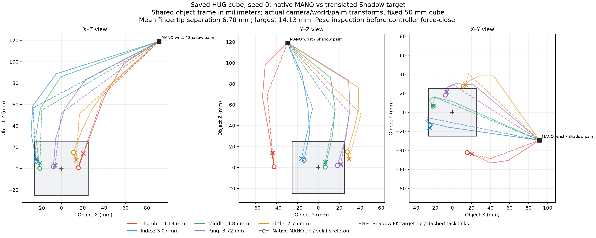
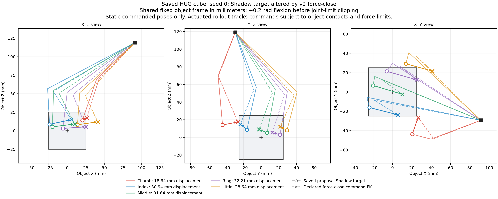

# Grasp generator mapping fidelity audit

Audited 14 October 2026 against `codex/project-work` at `7b14f26`.
This is a static source, transform and forward-kinematics audit. It reuses the
saved HUG cube output and synthetic joint configurations; it contains no new
generator inference, physics rollout, task labels, evaluation collection or
predictor fitting. Existing controllers and historical results are unchanged.

## What we can currently claim

The common proposal format makes grasps executable by one Shadow Hand, but does
not establish that all four native grasps preserve their original contacts.
HUG's saved cube has verified coordinate composition and measured approximate
landmark fidelity. ContactGen has reviewed transform algebra without a real
native sample. UniDexGrasp has a verified reference kinematic bridge without
its actual released source-hand asset/native sample. DexGrasp Anything has no
implemented mapping; its official 24-joint URDF gives a promising static bridge
which differs from the older 22-joint handoff assumption.

Human MANO and Shadow have different shapes and joint structures. Their fidelity
must be expressed as measured pose/contact errors, rather than hand identity.
Even Shadow variants require separate checks of joint frames, surfaces and
collision representations.

## The common simulator boundary

Each accepted proposal carries object-relative palm position/orientation in
meters, exactly 24 named Shadow targets in radians, and input/model provenance.
The evaluator composes `T_world_palm = T_world_object @ T_object_palm`.
[Composition](../src/grasp_failure_prediction/proposals/execution.py#L85).

The current evaluator checks object geometry identity, joint names/limits,
protocol compatibility and a maximum palm distance. It records static hand
self-contact, but this is not a gate proving collision-free acquisition or
native hand/object contact preservation.
[Checks](../src/grasp_failure_prediction/proposals/execution.py#L100).

Separate three quantities in every future mapping audit:

1. Native pose versus nominal translated simulator pose, before any motion.
2. Nominal pose versus the common controller's requested commands.
3. Requested commands versus achieved physical hand/object states.

The v2 controller approaches along world negative Z from 8 cm away, closes from
a near-open posture, then adds up to 0.2 rad flexion before a 15 cm lift and
2 second hold. Its joint limits can clip those added commands. The generator
does not provide that trajectory. This is a declared execution choice, not a
coordinate conversion defect.
[Executor](../src/grasp_failure_prediction/evaluation/runner.py#L660),
[v2 parameters](../src/grasp_failure_prediction/evaluation/configs/execution_protocols.yaml).

## HUG

The subsequent [individual HUG confirmation](HUG_MAPPING_CONFIRMATION.md)
adds exact native reconstruction, boundary tests and detailed surface evidence.
Its status remains partial; the next generators are not advanced automatically.

**Native process:** RGB-D, camera calibration and an object selection condition
the model. Its output includes right MANO camera-frame landmarks, mesh vertices
and wrist pose. The adapter removes the global wrist pose, rotates local axes
for Dex Retargeting, fits Shadow landmark vectors, then places the Shadow palm
at the predicted MANO wrist origin. This wrist-to-palm origin convention is
explicit; it does not equate their surfaces.
[Pinned source](https://github.com/KevinyWu/hug/tree/8d1c52d4c24bfae5a369e32e3f134f5601a02630),
[retargeter](../src/grasp_failure_prediction/evaluation/retargeting.py),
[placement](../src/grasp_failure_prediction/evaluation/case_runner.py#L219).

**Measured from an existing real model output:** The native file is the saved
cube/seed-0 proposal with SHA-256
`573cb003458d9d7cfe85b5b4a7877e414257b3e67d5abda04a09bd6d687fa0c2`.
Axis conversion is orthogonal with determinant 1. Camera/wrist/object
round-trip discrepancy is at most 1.11e-8 m; the saved proposal and independent
composed Shadow landmark placement differ by at most 6.62e-9 m.

Nominal fingertip errors in the shared object frame are thumb 14.125 mm,
index 3.068 mm, middle 4.852 mm, ring 3.724 mm and little 7.751 mm. Mean error
is 6.704 mm. The existing 10 mm mean gate passes despite the larger thumb error.
The palm-relative diagnostic agrees with full object/world errors to 6.30e-9 m
under the implemented placement convention; no additional hidden frame offset
was found in this case. Three abduction targets reach joint limits.

Solid lines show MANO skeleton; dashed lines connect the Shadow task landmarks,
not its full collision surfaces. Circles/crosses are corresponding fingertips.
The object is the unchanged 50 mm cube; all panels use its shared frame.

The declared extra closing command moves nominal fingertips by 18.644 mm
(thumb), 30.935 mm (index), 31.637 mm (middle), 32.212 mm (ring), and 28.645 mm
(little) in static FK. Mean separation from native fingertips becomes 30.623 mm.
These are commanded static configurations, not achieved physical positions:
object contact and force-limited actuators affect actual motion.

Static reconstruction of the existing final simulator state produces six
contacts, matching the saved contact count. Reconstructed pairs include four
object contacts on thumb/index/middle/ring distal bodies and two hand
self-contacts; original pair identities were not saved in the trajectory. Palm placement matches the saved final trace
within 2.14e-10 m. This verifies the saved Shadow contact reconstruction, not
equivalence to the native MANO contact pattern. Forces were not reconstructed
because the saved final state omits control/mocap/actuator state.

The native MANO mesh itself has 116 saved vertices inside the fixed cube and
15.213 mm maximum vertex-to-box penetration. This measures the saved native
mesh, not mapping error; a successful later lift does not validate its native
contacts. Landmark distances do not substitute for surface contact tests.

**Nominal contact-region inspection:** Reconstructing the nominal translated
pose at the original captured cube state, before approach/closing/lift, leaves
the object state unchanged and gives FK time zero. Native mesh vertices near
the object surface (2 mm and 5 mm bands), penetrating native vertices, and
compiled nominal Shadow contacts all cover the same three faces: -X, +Y, +Z.
There are six nominal Shadow/object contacts, no thumb/object contact, zero
hand/table contacts and one hand self-contact. Nominal Shadow collision
penetration reaches 11.196 mm. This and native vertex penetration are different
measurements, so they must not be interpreted as a direct penetration residual.

Matching the three faces supports coarse geometric coverage in this one case,
not equality of contact patches, normals, forces or physical success. The
nominal inspection and existing after-lift reconstruction are different states;
their finger contacts should not be conflated.

**Verdict:** Coordinate composition is verified for this case. Human-to-robot
pose preservation is approximate and quantified. Contact-region and physical
equivalence remain unverified; one successful HUG lift establishes execution
reproducibility, not general mapping fidelity.

## ContactGen

**Native process:** An object mesh is centered by its vertex mean. ContactGen
samples contact locations, hand parts and directions, then its official
`optimize_pose` refines a right MANO hand. Our worker retains the refined
vertices and 16 joint frames. The adapter restores centering, applies the
mesh-to-object transform, constructs 21 thumb-first landmarks and uses the
same MANO-to-Shadow retargeting path as HUG.
[Pinned demo](https://github.com/stevenlsw/contactgen/blob/1aea2b6ce498ec90c4af0dd4c5fbdd4a23db761a/demo.py),
[worker](../scripts/infer_contactgen_object.py#L137),
[adapter](../src/grasp_failure_prediction/proposals/contactgen.py#L203).

**Verified scope:** Source review found no confirmed centering, root-origin,
joint-order or axis defect. The wrist comes from frame 0, including the shaped
MANO root, rather than optimized translation alone. Upstream metric coordinates
are not multiplied by an extra millimeter conversion. Independent static FK
composition at two wrist configurations matches intended object-frame vectors
within 1.21e-16 m. This is transform algebra, not a measured ContactGen grasp.

**Missing evidence:** There is no real ContactGen native output locally for a
native-to-Shadow fidelity check. Tests mock retargeting/validation boundaries.
Input mesh/hash/vertex-mean checks do not independently establish that the
transformed mesh surface equals the MuJoCo collision geometry. Optimized MANO
parameters are not regenerated against the saved vertices/frames. The worker
does not retain sampled input points or predicted contact/part/direction maps,
so the original contact intention cannot yet be compared directly.

**Verdict:** Plausible reviewed implementation, awaiting real native-output
and contact evidence. HUG's measured residual must not be assigned to ContactGen.

## DexGrasp Anything

**Native process:** Point-cloud geometry and normals condition diffusion; an
optional optimizer enables physics-guided sampling. The pinned DexGraspNet
configuration normalizes translation and 24 joint values. The released
visualizer undoes those normalizations and random object rotations, exporting
translation, 6D rotation and 24 joints (33 values).
[Pinned visualizer](https://github.com/4DVLab/DexGrasp-Anything/blob/86353d710ca71d0f547f0d8b15cc8ca959c78163/models/visualizer.py#L119),
[native hand model](https://github.com/4DVLab/DexGrasp-Anything/blob/86353d710ca71d0f547f0d8b15cc8ca959c78163/utils/handmodel.py#L225).

**Concrete handoff discrepancy:** The existing handoff asks for a free palm
and 22 named joints using the DexGraspNet MJCF mapping. The official DGA
generator uses a different 24-joint URDF rooted at the forearm, including both
wrists. At zero joints its forearm-to-palm displacement is
`[0, -0.010, 0.247]` m and changes with wrist configuration. The worker must
compose the actual palm frame and retain all wrist articulations, rather than
silently discard them or treat root translation as palm translation.
[Current handoff](DEXGRASP_ANYTHING_CLOUD_HANDOFF.md),
[official URDF](https://github.com/4DVLab/DexGrasp-Anything/blob/86353d710ca71d0f547f0d8b15cc8ca959c78163/assets/urdf/sr_grasp_description/urdf/shadowhand.urdf).

**Measured static bridge candidate:** Pure URDF FK, preserving the computed
source palm pose and matching all 24 joints by name, was checked on zero plus
64 deterministic random configurations inside shared joint limits. Maximum
fingertip separation was 0.100 mm (little); thumb was 0.080 mm; the other three
tips agree to numerical precision. Joint origins/axes and collision assets are
not byte-identical, so this is evidence for a dedicated mapping candidate,
not permission to reuse another source identity or a registered acceptance.

The documented smoke command also inherits upstream `dataset.active: real_dex`
unless overridden, despite our pinned checkpoint being DexGraspNet. It omits
`OPT`, so physics-guided sampling is disabled. Dataset/normalizer, object scale,
normals, stage and optimizer configuration must be explicit in the eventual
worker; the upstream visualizer's dataset-average scaling cannot replace our
registered object's exact physical dimensions.

**Verdict:** Native format and a promising kinematic bridge are audited. Actual
mapping remains `unsupported_pending_official_mapping` in the registry; no
fresh DGA sample or implemented decoder has been validated.

## UniDexGrasp

**Native process:** Object/table point clouds feed IPDF rotation sampling and
Glow translation/joint generation. Official ContactNet-based test-time
adaptation (TTA) can refine the pose; a separate learned policy executes it.
Our worker implements the non-joint IPDF+Glow stage before TTA. The adapter
undoes canonical rotation, composes input-to-object and actual source palm
offsets, verifies a compiled palm/finger kinematic certificate and maps 22
source finger joints into 24 target joints with fixed target wrists.
[Pinned source](https://github.com/PKU-EPIC/UniDexGrasp/tree/36c9bfcf7cedc987dd15e2384c548e51d5aadc21),
[worker](../scripts/infer_unidexgrasp_proposals.py),
[adapter](../src/grasp_failure_prediction/proposals/unidexgrasp.py).

**Measured reference bridge:** The exact registered DexGraspNet reference asset
matches the certificate. Across 112 synthetic static joint configurations,
maximum tip error is 1.751 mm (little), thumb 0.422 mm and the other tips
approximately numerical zero. Two all-bound corner configurations slightly
exceed target limits and would be rejected by execution preflight rather than
silently clipped.
This tests the shared reference bridge, not a real UniDexGrasp-generated pose
or its unavailable released generation hand asset.

The certificate covers body/joint/tip kinematics, not collision geometry,
friction or inertia. Source capsule/box surfaces and target URDF collision
surfaces differ. Matching tips within the maximum-per-tip 2 mm gate does not
establish equivalent contact patches or stability. Comparison must identify
pre-TTA versus refined TTA outputs; replacing the native learned policy with
our fixed executor changes execution semantics.

The certificate's scope was checked explicitly: doubling a source proximal
capsule radius and changing palm inertial mass leave the kinematic certificate
unchanged, while changing a fingertip-site offset changes it. Raw asset hashes
change in all three cases. These controlled mutations occur only in temporary
copies and demonstrate why source-asset identity and kinematics cannot be used
as a surface/dynamics equivalence certificate.

Pure upstream FK parser and MuJoCo agree on joint order and body positions to
71.5 nanometers across 18 synthetic poses each with default and nonidentity
root placement. This checks parser/frame consistency on the reference proxy,
not availability of the actual released UniDex hand asset.

**Verdict:** Reference kinematic bridge has quantitative evidence. Actual
UniDex asset acceptance, generated pose fidelity and contact preservation
remain pending. The full original UniDexGrasp system is not reproduced.

For externally imported refined `tta_hand_pose`, the current contract requires
a ContactNet checkpoint hash but does not bind its full TTA configuration.
That provenance gap should be closed before using such imports in a comparison;
it does not affect the current worker's explicitly pre-TTA stage.

## Acceptance evidence still needed

For each actual native sample, compare the same object at its exact registered
scale/frame; retain source units, centering, canonical transforms, joint order,
stage and source asset identities. Verify declared transforms against actual
input surfaces rather than relying solely on copied geometry hashes.

Measure nominal palm position/orientation, every fingertip, intermediate finger
segments and contact-bearing surfaces in the shared object frame. Report native
and translated object distances, contact regions/normals, self-intersection and
penetration. MANO retargeting errors need to be judged relative to the object's
contact geometry; the current 10 mm mean gate is not a scientific contact
acceptance criterion. Report each rejection and its reason separately.

Record controller-induced changes separately and preserve v2 unchanged while
auditing nominal mappings. Any later executor change needs a new protocol and
comparison with the historical one. A static pose check cannot prove identical
physical grasp behavior across different hand surfaces and simulators.

The HUG-only finer-grid and anatomically matched surface follow-up is complete,
and numerical transform/joint consistency extends to 32 existing poses; see
[the continuation](HUG_MAPPING_CONFIRMATION.md). Contact fidelity remains
unconfirmed. Wrist/palm proxies on all 32 poses and surfaces on six existing
apple/milk-box/mug cases are now checked; see the new section in
[the HUG note](HUG_MAPPING_CONFIRMATION.md). A common translation does not
explain the residuals, and native/target surface proximity differs on both
collision and visual references. The object collision approximation itself
also differs from the visual mesh. Next audit that geometry and define a
contact-preservation objective and separate calibration/validation groups
before changing HUG's mapper. HUG remains active before advancing providers.
The proposed cross-generator prediction study remains unrun; no new evaluation
data or fitting accompanied these static checks.

## Audit artifacts and reproduction

Reports, the existing-HUG overlay and snapshot scripts are in
[the audit artifact directory](../research_artifacts/grasp_mapping_audit_2026-10-14/).
Scripts retain the exact local input/source paths used; they are historical
diagnostics, not provider inference or a new dataset exporter. Reports distinguish
real saved HUG output from synthetic FK tests and record no task labels.
