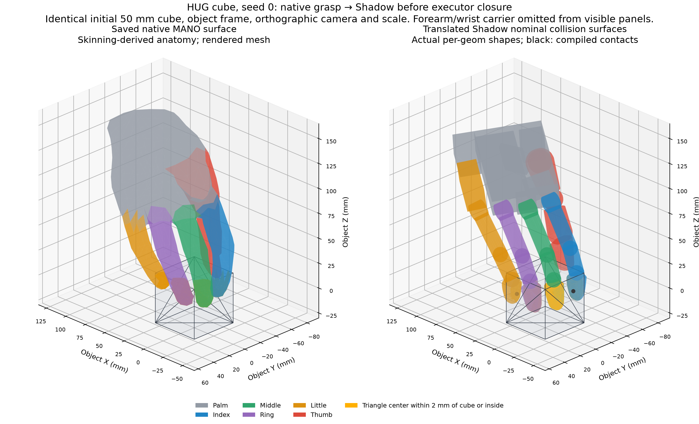
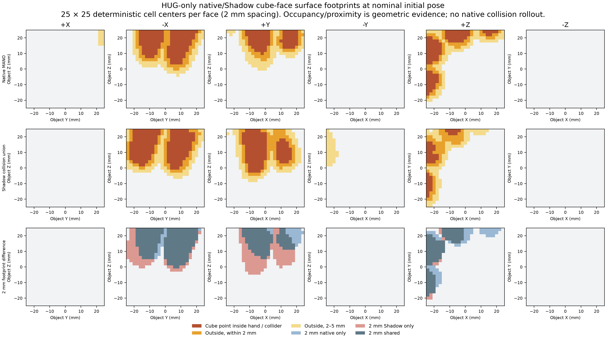
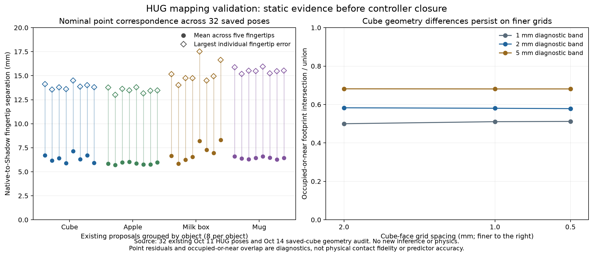
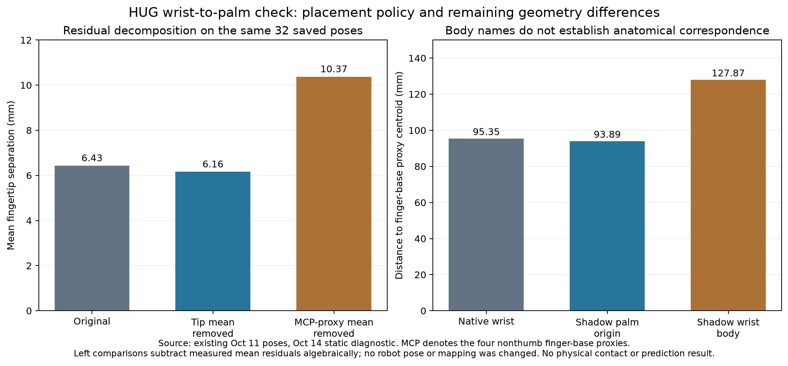
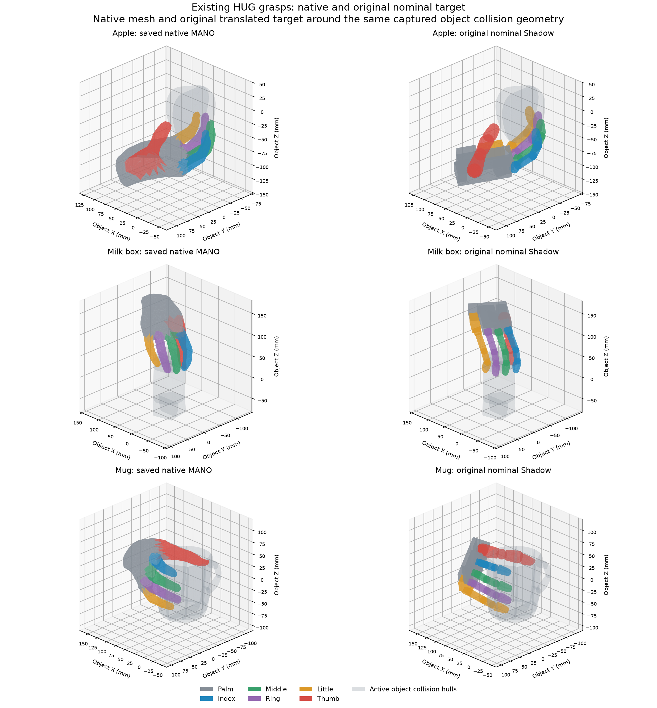
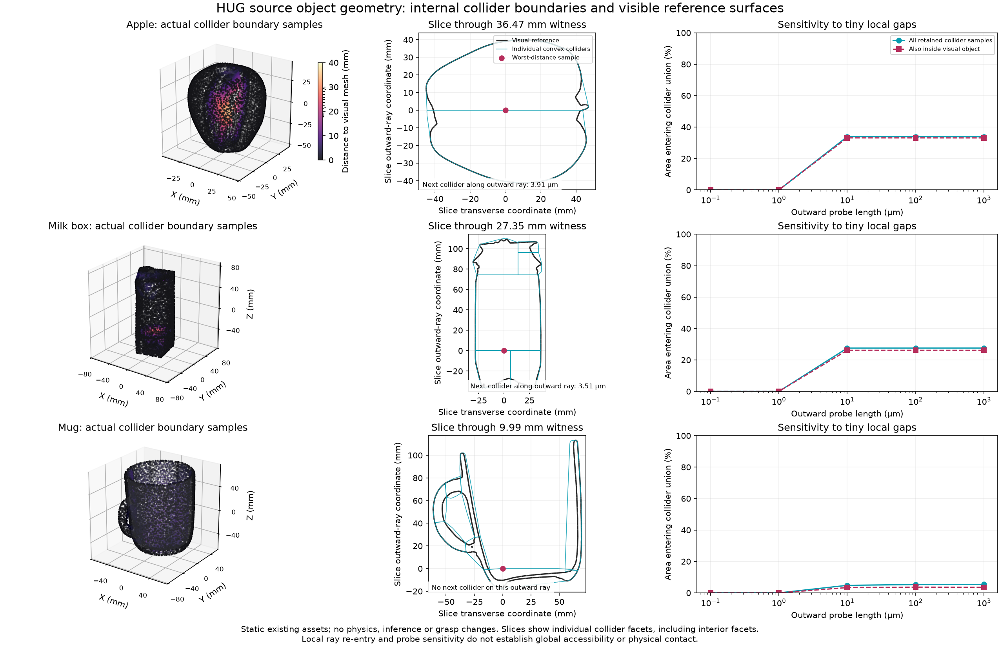
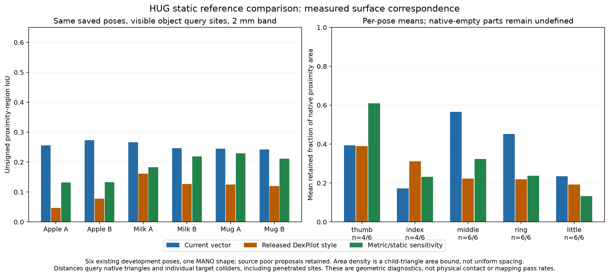
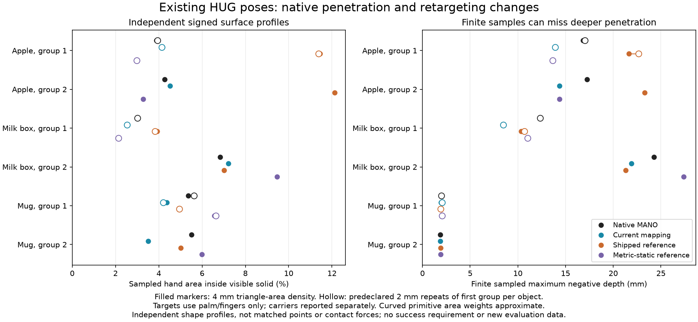
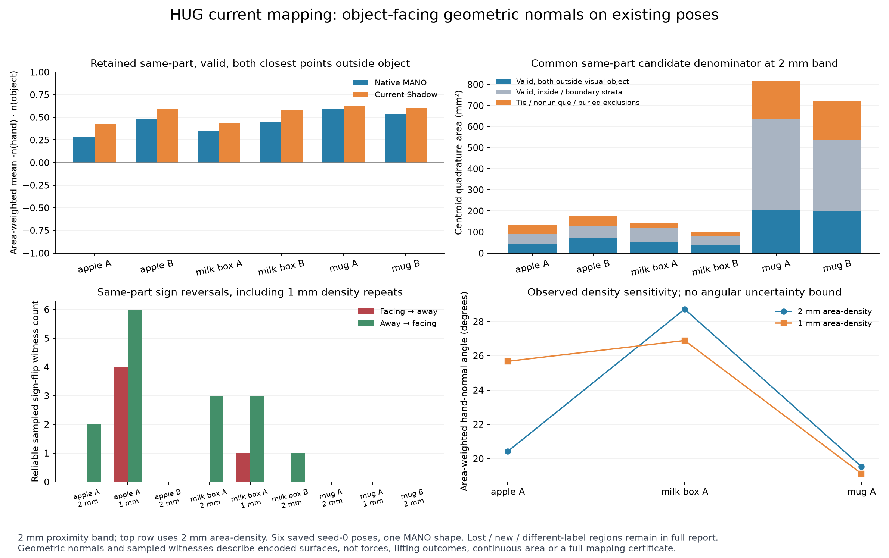
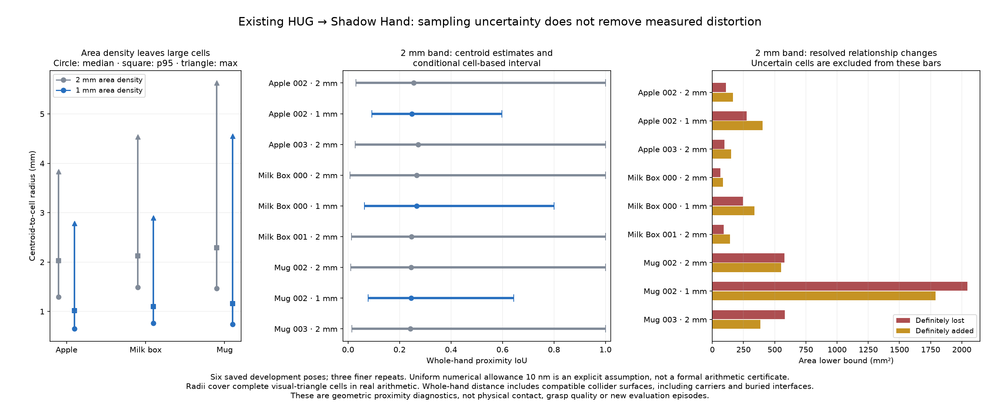

# HUG mapping confirmation

14 October 2026. HUG is the first individual generator under review. The evidence phases
reuse saved cube/apple/milk-box/mug proposals; no new grasp-generator inference,
physics rollout, evaluation dataset or predictor training occurs in these audits.

**Current conclusion:** Native reconstruction and coordinate/joint conversion
pass within checked scope. Strict same-part surface-relationship preservation
fails in all six detailed cases under explicit numerical assumptions. Continuous
physical contact and failure-label equivalence remain unconfirmed. HUG stays
active before ContactGen, DexGrasp Anything and UniDexGrasp.

## What HUG produces

RGB, registered depth, camera calibration and an object selection condition
HUG's prediction. The native result describes a right human MANO hand: shape,
15 finger-joint rotations, global wrist rotation/translation, 21 landmarks,
778 vertices and 1,552 faces. It does not directly supply Shadow joint targets.

For this check the source output is the already saved cube proposal, SHA-256
`573cb003458d9d7cfe85b5b4a7877e414257b3e67d5abda04a09bd6d687fa0c2`.
Object scale/frame, observation and source runtime remain those of
[the completed single HUG run](HUG_SINGLE_EVAL_2026-10-13.md).

## Check 1 Native representation

The pinned official HUG MANO wrapper reconstructs the saved hand from its
existing pose/shape parameters without loading or sampling the HUG generator.
All 778 vertices, 21 landmarks and wrist rotation match the saved export exactly;
camera reprojection also matches all 21 saved 2D landmarks exactly.

HUG exports the closed MANO face table: 1,538 original triangles and 14 wrist-cap
triangles. Those 1,552 face indices match exactly. The licensed asset was hashed
and read locally; it is not copied into the audit.

**Result:** Native representation confirmed for this saved output. This checks
that the displayed human hand is the one encoded by the generator output.

## Check 2 Coordinate and joint conversion

The adapter removes the global camera/wrist transform, applies the proper
MANO-to-operator rotation, and passes wrist-to-tip/middle-link vectors to Dex
Retargeting. The static configuration preserves metric dimensions, disables
temporal filtering, and runs 20 optimization iterations. Joint values are
reordered by name and limited to the actual Shadow model.

The Shadow palm is placed at the predicted MANO wrist using an explicit origin
convention. Object-relative palm pose then composes with the simulated object's
world pose. Correct transform algebra does not prove that this morphology
correspondence preserves surfaces.

Independent algebra checks pass for 64 nonidentity object transforms, 192
quaternion normalization cases and 128 permutations of the actual saved joint
values. Three invalid quaternions and a missing joint are rejected. Sixty-four
global changes of camera coordinates preserve wrist-local landmarks to numerical
roundoff. These manufactured coordinate changes are not new grasps or task cases.

Eighteen existing decoder/frame/retargeting/static-FK tests pass with all MuJoCo
stepping APIs prohibited. One unrelated stock-Adroit test is excluded. The
checks include agreement between Dex/Pinocchio and MuJoCo forward kinematics.

**Result:** Coordinate and joint conventions confirmed within tested scope.

## Check 3 Nominal grasp geometry and surfaces

Compare the native hand and the nominal Shadow target around the identical
50 mm cube before approach, closing or lifting. Do not adjust scale or placement
to improve the appearance of agreement.

Existing object-frame fingertip errors are thumb 14.125 mm, index 3.068 mm,
middle 4.852 mm, ring 3.724 mm and little 7.751 mm. Mean error 6.704 mm passes the
existing 10 mm mean gate, while three abduction joints are at their limits.
The gate is an implementation tolerance, not proof of contact preservation.

The native near-surface vertices and nominal Shadow collision contacts cover
the same three cube faces (-X, +Y, +Z). This is coarse agreement only. Native
vertex penetration reaches 15.213 mm and nominal Shadow collision penetration
11.196 mm; these are different measurements and cannot be subtracted as a
mapping-error score. The nominal Shadow thumb does not contact the object.

Native poor grasps must also be represented faithfully. Native penetration or
later task failure alone does not establish a mapping defect, and validation
must not silently repair or remove poor proposals. The relevant question is
which contact locations, fingers, normals or penetration patterns are changed
by conversion.

**Result:** Nominal pose is approximate. Full contact preservation remains
unconfirmed. The wrist-to-palm morphology convention is not independently
calibrated by the successful cube lift.

### Surface comparison at the same pose and scale

Left is HUG's exact saved MANO mesh, colored by skinning-derived anatomical
parts. Right is the nominal Shadow collision geometry. Both use identical
object axes, camera, limits and metric scale. Forearm/wrist carrier geometry
is omitted from visible panels so the fingers remain readable.

The target reconstruction uses actual analytic primitive shapes and each
mesh geom's own convex hull, consistent with
[MuJoCo 3.3.7 collision geometry](https://mujoco.readthedocs.io/en/3.3.7/computation/index.html#collision-detection).
It does not substitute a single convex hull for the whole hand. The saved
native mesh is closed, consistently oriented and nondegenerate; the review
does not establish absence of native self-intersection.

The diagnostic queries 3,750 fixed cube-face cell centers, 2 mm apart. A query
belongs to a footprint if it is inside the native hand / a target collider or
lies within the chosen 2 mm or 5 mm proximity band. This measures occupied-or-near
geometry, including penetration; it is not actual physical contact area.

At 2 mm, the native footprint is 1,876 mm², Shadow 2,208 mm² and shared footprint
1,504 mm². Intersection over union is 0.583; at 5 mm it is 0.682. These are
resolution- and band-dependent diagnostics, not prediction accuracy or a
mapping pass threshold. The dominant index/middle (-X) and ring/little (+Y)
regions persist, while detailed regions shift or broaden. Native little-finger
coverage on the top face (+Z) is absent from the target's 2 mm footprint.

The geometric nearest-surface normal differences on -X/+Y/+Z have medians
21°/72°/40° where both surfaces are outside and within 5 mm. They compare
nearest surfaces at common cube queries, not necessarily the same finger or
paired physical contact normals. Skinning labels are anatomical proxies.

**Interpretation:** Correct coordinate placement retains the gross grasp
arrangement, but does not preserve the detailed human-hand surface footprint
when converted to this robot. The finer evidence makes the remaining fidelity
gap explicit; it does not prove a frame defect or native grasp success/failure.

## Check 4 Execution changes

The current v2 executor starts near-open, approaches along world negative Z,
then adds bounded finger flexion before lifting. Its extra closing command
moves this case's fingertips by 18.644–32.212 mm in static FK. Actual physical
motion is constrained by contacts and actuator forces.

Those commands are separate from the nominal mapping. The existing successful
lift shows that one adapted grasp can execute; it does not establish fidelity
to native human contacts or to the original HUG evaluation system.

The current adapter, controller, predictor and historical labels remain
unchanged. No new execution experiment is part of this confirmation check.

## 14 October continuation: broadened static checks and finer surfaces

The static follow-up uses 32 distinct existing HUG native poses across cube,
apple, milk box and mug, in eight observation groups. Each object has two scenes
and four seeds. All share one MANO shape. The Oct 13 cube is a duplicate of one
of these sources. These are previously inspected development families, not a
new independent holdout or newly generated evaluation data.

Each native pose is bound by hashes and inference reports to the same recorded
HUG source/checkpoint. Saved mapping-code hashes match the current code. The
original Shadow target is recovered from each zero-noise episode's closing
endpoint at 2.16 s, before force-close: 24 named targets and a world carrier
pose. The cube's joint values match the current canonical proposal exactly.

Guarded static FK through each captured scene preserves its initial object
state and simulation time zero. Independent fixed-root URDF task-link positions
agree with the scene reconstruction within 7.845e-8 m. The reproduced mean-tip
error agrees with the original saved validation within 9.792e-9 m. Joint-limit
violations are zero. The floating carrier includes the URDF world-joint's
1.57079 rad fixed origin; comparing its quaternion directly with the operator
basis would be an incorrect frame comparison.

Across 160 fingertips, mean native-to-Shadow separation is 6.428 mm. Per-pose
means range 5.704--8.305 mm; the worst individual tip is 17.518 mm, the milk-box
scene-001/seed-0 thumb. Object-level means are cube 6.405 mm, apple 5.865 mm,
milk box 7.000 mm and mug 6.440 mm. These point residuals do not establish contact
preservation, and the existing 10 mm mean implementation gate remains separate
from scientific acceptance.

A protocol frozen before the cube refinement specifies 2, 1 and 0.5 mm grids
and 1, 2 and 5 mm diagnostic bands. The actual centered 50 mm box and all 45
hand/object collider compatibilities are verified, with no explicit pair or
body-exclusion overrides. The previous 2 mm grid's 2/5 mm global results
reproduce exactly. At the 2 mm band, occupied-or-near IoU is 0.582946, 0.580406
and 0.578557 across the three grids. At 5 mm it is 0.681668, 0.681060 and
0.681128. The main discrepancy persists; this is stability over tested grids,
not proof of continuum convergence.

Independent unsigned per-finger proximity uses open native anatomical triangle
subsets and actual target colliders. It does not invent enclosed finger volumes.
At the finest grid and 2 mm band, top-face little-finger proximity is nearly
lost: native 57 mm^2, Shadow 0.5 mm^2, shared 0.25 mm^2. Thus the earlier coarse
absence finding must be qualified at finer resolution. Native little-finger
+X coverage and target index -Y coverage remain unmatched in the 5 mm sweep.

Normal comparisons now require globally exterior near queries with matching
anatomical labels and retain unmatched/mismatched queries separately. The fine
2 mm band contains 748 matching and 84 different-label common queries. Among
matching pairs, 548 have both closest hand points inside the cube, 100 one
inside, and 100 neither inside. Median angle is 25.56 degrees over the matching
subset, versus 59.99 degrees when neither closest point is inside. This shows
why a small conditional closest-point separation does not establish valid
physical contact correspondence. Skinning labels, facet normals and deterministic
grid areas remain geometric proxies; they are not physical contact annotations.

### Argument supported by these checks

Let T_AB map coordinates in frame B into frame A; W is world, O object, C camera,
M native MANO and P target palm. The native object-relative pose is
`T_OM = inverse(T_WO) * T_WC * T_CM`. Execution composes the saved target as
`T_WP = T_WO * T_OP`. A common rigid change of world coordinates cancels in the
object-relative expression. For the proper MANO/operator rotation A,
`v_operator = A * v_MANO` and `R_Woperator = R_WMANO * transpose(A)` imply
`R_Woperator * v_operator = R_WMANO * v_MANO`. This explains why coordinated axis
conversion preserves represented world geometry. Exact joint-name matching and
independent FK then check that the target model realizes the stored joint policy.

The numerical evidence supports decoding, placement and joint conventions in
the tested scope. Choosing the Shadow palm as the MANO wrist anchor and fitting
robot fingers to human vectors are additional morphology assumptions. The
surface discrepancies demonstrate why those assumptions cannot be justified by
transform algebra or a successful lift alone. They need separate evidence before
claiming preservation of the original grasp's contact relationships.

All measurements, frozen protocol, scripts and hashes are in
[the continuation bundle](../research_artifacts/hug_mapping_refinement_2026-10-14/README.md).
No generator inference, physics rollout, evaluation-data collection, predictor
fit, calibration or adapter/controller change accompanied this continuation.

## 14 October continuation: wrist/palm and other existing objects

The [new evidence bundle](../research_artifacts/hug_palm_object_validation_2026-10-14/README.md)
checks all 32 existing poses for anchors and anatomical proxies, and both
existing seed-0 groups for apple, milk box and mug for finger surfaces. No
inference, physics rollout, evaluation case, label or fitting is performed.
The original targets and initial objects are held fixed; poor native proposals
are retained. These are development diagnostics with one MANO shape.

### Wrist-to-palm placement

The saved native MANO wrist and selected Shadow palm origin agree within
1.429e-16 m. Shadow's actual named wrist body is 34 mm away, matching the URDF
WRJ1 origin. Equating the two wrist body names would therefore test a different
placement policy. The measured anchor confirms implementation of the declared
policy, not exact anatomical equivalence.

Explicit nonthumb finger-base proxies use native landmarks 5/9/13/17 and actual
Shadow FFJ3/MFJ3/RFJ3/LFJ3 joint anchors. Mean native wrist-to-base-centroid
distance is 95.351 mm, versus 93.889 mm from Shadow palm and 127.866 mm from
its wrist body. Native index-to-little base span is 73.136 mm, Shadow 66.517 mm.
Transverse, longitudinal and signed cross-product proxy directions differ by
5.385/6.441/7.778 degrees on average. These points and directions are declared
proxies, not ground-truth identical tissue regions or an identified correction.
Open skinning-assigned palm bounds include cap/seam vertices and must not be
interpreted as anatomical palm thickness.

Residual decomposition separates a common translation from differential point
errors without moving any pose. One shared fingertip mean explains 14.61% of
squared tip error: mean separation 6.428 to 6.156 mm after algebraic subtraction.
Separate per-case means explain 17.35%. Differential thumb/little means remain
11.785/9.789 mm. Across all ten task points, a shared mean explains only 4.29%.
The MCP-proxy-derived shift differs from the tip-derived shift by 8.237 mm and
increases mean tip separation to 10.371 mm when subtracted algebraically.
Thus one placement translation alone is not a complete explanation. This does
not identify every cause, rule out a revised mapping, or validate calibration.

### Finger surfaces on apple, milk box and mug

The six cases are fixed before measurement by source order, with seed 0 in
each existing group. Each object's captured active collision geoms are used
individually: 2 for apple, 7 for milk box and 15 for mug. Actual disabled visual
mesh triangles provide a separate reference. Anatomical labels remain proxies;
open native finger subsets are used only for unsigned proximity.

Collision-union sampling v3 excludes interior/duplicate queries and rejects
outward probes entering another hull. This corrects exactly abutting opposite
normal interfaces retained by the preserved v2 pilot. V1 was not executed;
v2 is superseded for these collision metrics. V4 queries actual visual triangles
as an additional metric family, without replacing v3. Protocols and executed
script hashes are preserved; old published cube evidence is not rewritten.

All cases use deterministic midpoint subdivision with maximum child area
4 mm^2, repeated at 1 mm^2 for the first group of each object. This is an area
density, not uniform spacing or a maximum edge guarantee. Samples carry actual
area weights. At the 2 mm proximity band, whole-hand unsigned proximity IoU
ranges 0.195--0.290 on collision queries and 0.243--0.273 on visual queries.
Occupied-or-near IoU is 0.380--0.449 and 0.441--0.512 respectively. These metric
families include penetration and cannot be pooled or called mapping accuracy.
Shadow unsigned distance is to individual collider surfaces and may approach
buried collider interfaces at overlapped, penetrated sites; it is not exact
distance to the exterior hand-union boundary. Occupancy is separately measured.

Visual-surface unsigned IoU changes from coarse to finer density by -0.00798
for apple, +0.000000605 for milk box and +0.000145 for mug. The discrepancy
persists across those tested densities; this is not a convergence proof.
For the first mug group, native/Shadow index proximity areas are 1,601.7/1,444.8
mm^2 but share 275.1 mm^2. Little-finger areas are 660.3/1,124.4 mm^2 and share
160.7 mm^2. Apple little fingers share about 39 mm^2 in each group despite
native areas 203/214 and target areas 305/311 mm^2. These show lost and new
anatomical proximity regions on the visible object, not actual contact forces.
Exterior normal comparisons retain same/different labels and nearest-point
inside-object categories; conditioning on shared proximity cannot certify
correspondence or justify filtering poor native grasps.

Collision and visual object surfaces are also different. First-group reverse
collision-to-visual area-weighted distances average 4.42/2.76/2.12 mm for
apple/milk/mug, with maxima 36.47/27.35/9.99 mm. This establishes a separate
object-geometry fidelity question; it does not prove a single cause such as
decomposition gaps or show whether the differing surfaces affect this grasp's
outcome. Audit that approximation before attributing all proximity differences
to retargeting. No collider or nominal mapping was changed.

The figure displays actual native triangles and nominal target colliders at
identical camera, limits and metric scale per pair. Individual gray convex
hulls include overlap; this is not an exact clipped collision-union rendering.

Primitive/triangle/winding checks pass; accelerated triangle queries agree
with the prior NumPy routine within roundoff and the old cube baselines
reproduce exactly. All six static poses reproduce prior FK exactly. Guards
prevent stepping, time stays zero, object state and targets stay fixed, and
recorded inputs, production code, frozen predictor and manuscript retain
their hashes. Optional query arrays are diagnostic derivatives kept locally,
not evaluation data or new training examples.

## 14 October continuation: object causes and fixed reference methods

[The geometry/reference
bundle](../research_artifacts/hug_geometry_reference_validation_2026-10-14/README.md)
separates object approximation, numerical retargeting, common-query surface
relationships and signed hand/object profiles. It uses only saved development
proposals: all 32 for reference point/FK checks, and the same six seed-0 noncube
cases for detailed geometry. No new generator inference, physics, eval
episode/label, predictor fit or production change occurs.

### Object approximation is inherited, with no tested placement error

Raw source OBJ vertices with source XML scale/transforms reconstruct compiled
per-geom object vertices within 4.146/7.365/7.690 nm for apple/milk-box/mug. The
two saved observation groups share the same local compiled geometry. All 36
source simulation asset files match pinned HUG dataset download manifests. This
supports correct tested scale/frame placement; it does not establish
collision/visual equivalence.

The earlier apple/milk reverse-distance maxima, 36.47/27.35 mm, occur on
collision walls deep inside the visible solid. Outward rays meet the next piece
after about 3.91/3.52 micrometers in both raw and compiled geometry. These
witnesses explain retained internal walls at inherited narrow slits, rather than
a 27–36 mm outer placement error. Mug's approximately 10 mm worst witness lies
outside the visible solid with no next hull on that ray, exposing exterior
convex approximation around its lower interior profile. Other regions can have
other causes; rays do not prove global air access or finite-hand contact.

The prior 0.1 micrometer probe excludes abutting interfaces but retains wider
gaps. A larger probe would alter the diagnostic domain, not repair the physical
object. No collider or probe is changed to obtain a preferred score.
Vertex-rounding/tolerance effects and shallow insets remain distinct from true
internal gap-wall claims.

### Better fingertip fitting does not establish a better mapped grasp

The fixed reference is Dex Retargeting 0.5.0's released Shadow/five-finger
DexPilot-style adaptation, with scale 1.2 and filter alpha 0.2. It is not the
original Allegro implementation or a certified HUG-to-Shadow ground truth. A
separate metric-scale/no-filter sensitivity was frozen before measurement. Both
use fresh midpoint initialization, 20 static solves, all 24 joints and the same
MANO-wrist/Shadow-palm origin convention. Root orientation is recomputed through
the actual wrist chain for each q; it is not forced equal while wrist angles
change. No per-case tuning is used.

Current targets regenerate all 32 saved joint vectors exactly. Independent
Pinocchio/fixed MuJoCo FK agrees within 2.23e-16 m; fixed model/captured-scene
links within 1.01e-7 m. Mean tip error is 6.428 mm current, 21.343 mm released
reference and 2.353 mm metric/static sensitivity. Mean middle-link proxy error
is 6.829/26.377/13.811 mm. The sensitivity improves tips but increases ten-link
mean error from 6.628 to 8.082 mm. All optimizer calls return FTOL_REACHED
without fallback; no projected pinch activates in this sample. Raw, filtered and
physically clamped outputs remain distinct, with maximum clamp effects on links
at most 0.130 mm.

On exactly the same visible-object query sites, current whole-hand unsigned 2 mm
proximity IoU is 0.242634–0.272962, versus 0.046728–0.161568 released reference
and 0.132140–0.229001 metric/static. Current is higher in all six cases and the
three finer repeats. Per-finger tradeoffs differ: sensitivity retains more
native thumb/index proximity on average, while current retains more
middle/ring/little. Thumb/index conditional means each use 4/6 native-nonempty
cases; the other fingers use 6/6. Every lost/new/shared area and empty
denominator remains reported. This supports retaining the current mapper for
now, not certifying it as optimal or contact-equivalent.

### Signed profiles preserve evidence of poor native proposals

Native and target hand surfaces are sampled against the same closed visible
object triangles, with negative-inside distances. All six native triangle-area
profiles contain sampled penetration: maxima 1.87–24.28 mm and negative area
fractions 2.99%–6.84%. On first apple, native/current/released/metric profiles
have sampled maximum depths 16.84/13.93/21.64/13.65 mm and independent negative
fractions 3.89%/4.17%/11.45%/2.99%. At finer density, the released maximum rises
to 22.67 mm. Second milk-box metric/static depth is 27.37 mm versus native 24.28
mm.

These are independent shape profiles, not matched-point residuals or
intersection volumes. Native original-vertex count profiles are separate from
triangle-area profiles; target curved primitive query sites are projected onto
exact analytic surfaces, with approximate tessellation area weights. Primary
mapped profiles cover palm/fingers, while coarser carriers remain separately
reported. Native self-overlap surfaces and sampled target-union exposure also
differ in domain. Finite sampled maxima may miss deeper penetration, and zero
negative samples cannot certify no intersection. Per-finger proximity misses and
exterior-gap misses remain separate geometric definitions, not physical contacts
or outcomes. Lower penetration alone cannot establish a faithful mapping.

### Protocol history and numerical bounds

Frozen per-phase protocols, executable scripts, exact compressed reports,
provenance and sanity checks are preserved. Reference targets satisfy
full-precision source URDF bounds. A legacy reference metadata table named
physical_lower_rad/upper_rad actually stores captured-scene decimal bounds; [the
correction](../research_artifacts/hug_geometry_reference_validation_2026-10-14/reference/corrections/README.md)
preserves original bytes and verifies actual source-limit clamping. Some
reference q values exceed the rounded captured-scene lower bound by 3.878e-7
rad. This is a static representation audit, not a demonstrated production
preflight rejection; production validates directly compiled source URDF bounds.
No target is modified to pass the scene comparison.

The incomplete surface V2 and signed V1 pilots remain versioned; their amended
final protocols are not pooled with them. Current surface baselines reproduce
exactly. Stepping guards, zero-time/object invariants, mathematical sanity
checks and protected code/model/manuscript/input hashes pass. No numerical or
surface score is adopted as a scientific acceptance threshold.

## 14 October continuation: orientation, cell uncertainty and acceptance

[The new evidence
bundle](../research_artifacts/hug_orientation_uncertainty_acceptance_2026-10-14/README.md)
completes object-facing normal measurements and cell-radius proximity bounds on
the same six seed-0 noncube development poses, with the three already declared
finer first-group repeats. These are nine quadrature resolutions, not nine
independent proposals. A supplemental static MANO reconstruction now covers all
32 saved native exports. No new HUG proposal inference, retarget optimization,
physics rollout, eval record/label or fitting occurs.

### Native reconstruction now covers all 32 saved proposals

The pinned official MANO wrapper reconstructs every saved pose/shape on CPU: all
778 vertices, 21 landmarks and wrist rotation elements match exactly for all 32
distinct proposals; all 1,552 capped face indices match. The original float32
representation allowances are reused, with actual residuals zero. This is
saved-parameter hand FK, not HUG generator inference. Camera reprojection
remains the separate original representative-cube check.
Production/model/manuscript and licensed assets remain hash unchanged.

### Orientation states sometimes change

At common visible-object queries, compatibility is minus the dot product of
outward hand and object normals. Positive denotes facing/opposed normals,
negative away/aligned normals, and the numerical deadzone denotes uncertainty.
Native/mapped exterior and same-nearest-part matching, unique features, object
membership, tied normals, buried target points, lost/new regions and missing
references remain explicit. Normals describe encoded surfaces, not forces.
Closed oriented topology supports winding under declared assumptions; exhaustive
self-intersection checks are not supplied.

At the 2 mm band, six coarse conditional outside-object regions have
area-weighted mean native/mapped hand-normal differences 19.537–28.720 degrees.
The eligible areas are only 36.648–206.876 mm², so these means cannot establish
full-region preservation. Fine apple reveals four facing-to-away and six
away-to-facing query sites, versus zero and two at coarse density. Fine milk
reveals one and three. The fine apple mean angle is 25.677 versus coarse 20.426
degrees. Mug's absence of sampled sign flips at this band is not a continuous
orientation pass.

Independent replay verifies two fine-apple witnesses from original
source/current geometry: middle compatibility +0.185621 to -0.052533; ring
-0.031983 to +0.382560. Point/distance agreement is within 1e-12 m and
normal/score elements within 1e-12 (dimensionless), with unique features,
exterior queries and both closest points outside the visible object. Introduced
facing can repair a poor native relation and still change it. Witness counts and
centroid weights do not certify continuous changed-normal area; distance
Lipschitz bounds cannot bound nearest-feature angular discontinuities.

### Spatial uncertainty does not explain away the proximity changes

The prior visual child triangles are reconstructed in exact query/weight order.
Each centroid radius is its maximum distance to the three vertices, covering the
whole convex triangle. For fixed-set unsigned distance d, radius r and assumed
numerical allowance epsilon, every cell distance lies within
[max(0,d-r-epsilon), d+r+epsilon] in real arithmetic, conditional on epsilon
bounding arithmetic/query error. Definite/possible near masks give conservative
shared/lost/new area and ratio intervals. These are spatial bounds, not
statistical confidence intervals.

At the 2 mm band, coarse median cell radii are 1.292–1.487 mm, with maximum
5.627 mm; finer medians are 0.649–0.760 mm, maximum 4.551 mm. Small triangle
area alone therefore does not ensure small spatial error. Unresolved whole-hand
relationships occupy 8.611–16.821% of the entire coarse visible surface and
5.121–9.779% in finer repeats. Stable centroid IoU estimates coexist with wide
conditional area bounds.

Nevertheless every detailed case contains definite same-part lost or added
proximity cells under the assumed 1/10/100 nm allowances. An apple middle-finger
cell of area 1.038163 mm² has native distance at most 0.936781 mm and mapped
distance at least 1.909627 mm throughout the cell under the primary 10 nm
allowance: a definite lost 1 mm-band relationship. Another example is the coarse
first mug's index at 2 mm: lost-area lower bound 221.85 mm² and added-area lower
bound 245.15 mm². Independent anatomical areas overlap and are not summed. There
are 178 selected auditable cells with source/cell/protocol hashes.

The numerical allowances are explicit assumptions, not a formal global
floating-point certificate inferred from finite tests. Their sensitivity does
not change which parts have definite mismatches. Distances to individual target
collider surfaces may include buried interfaces and mapped whole-hand
diagnostics include carriers. Native carrier references are unavailable and
excluded from the six-part acceptance gate. Signed occupancy, continuous
penetration, physical contacts and normals do not inherit these
unsigned-distance bounds.

### Acceptable mapping is now an explicit scoped contract

[The acceptance definition](HUG_MAPPING_ACCEPTANCE.md) and frozen rule
distinguish numerical correctness, strict same-part surface relationships and
later failure-label adequacy. The rule was frozen before reading these new
measurements; the already inspected cases remain development evidence. At the
declared 1/2/5 mm bands, a positive-area definite lost/added same-part cell or a
reliable sampled orientation sign reversal fails strict preservation. PASS
requires complete certified equal relationships, including valid orientation
coverage; unavailable or ambiguous required evidence remains UNRESOLVED. Zero
detected changes alone cannot become PASS. No average tip/IoU/angle or
successful-lift threshold is used. This defines the strict claim, not a
universal zero-error requirement for every useful retargeter.

The [machine-readable
application](../research_artifacts/hug_orientation_uncertainty_acceptance_2026-10-14/acceptance/acceptance_application.json)
reports numerical conversion PASS within recorded scope, strict geometric
preservation FAIL in all six detailed cases and three finer repeats conditional
on the numerical assumptions, continuous physical-contact equivalence
UNRESOLVED, and outcome/predictor adequacy/independent generalization
NOT_TESTED. HUG has a correctly implemented approximate conversion with measured
distortion; it has not earned acceptance as a contact- or
failure-label-equivalent mapping.

### Verified versions and scientific limits

Sampling V1 stopped before a case report on an overstrict comparison against
incomplete old far-distance broad-phase values. Frozen V2 retains exact 1/2/5 mm
decisions and compares old distances only where complete within 5 mm.
Orientation V1 was amended before saved-case measurements to cover
native-near/target-far candidate features; frozen V2 uses the exact mapped
minimum plus tie allowance. A missing-sibling-export partial V2 run is separate
from the completed unchanged rerun. All histories and original metrics remain
intact.

Six manufactured sampling tests, 100 independent exact strip-area checks,
rotated-box sign/tie/membership tests, independently replayed orientation
witnesses, all protocol/library/input hashes, zero-time/object/qpos invariants
and 110 protected source/model/paper hashes pass. All nine orientation sibling
bindings match the final sampling V2 protocol and original query caches. No
licensed asset, checkpoint, scene binary or scratch query array is published. No
mapper, collider, controller, frozen predictor or manuscript changed.

## Confirmation boundary and next step

Native reconstruction now passes on all 32 saved inputs; coordinate/joint
conversion passes within tested scope. Strict declared-band anatomical
surface-relationship preservation fails on all six detailed development cases
under the explicit numerical allowances. Continuous contact and failure-label
equivalence remain unconfirmed. HUG is not signed off as a faithfully preserved
native grasp.

The requested orientation and sampling checks and scoped acceptance definition
are complete. The current production mapper stays unchanged while its measured
limitations are recorded. Next use the retained finger/region witnesses to
specify a versioned retargeting improvement against the frozen contract, or
explicitly adopt a narrower research claim about the documented
retargeted-simulator pipeline. Approximate adequacy needs a separately justified
distortion budget and independent validation, not a threshold selected to make
these cases pass. Outcome sensitivity and new unseen-object tests remain future
work; inspected cases are not a holdout. No new eval collection or predictor
training is authorized by this static audit.

See [the four-source audit](GRASP_MAPPING_FIDELITY.md) for original papers and
source-specific contracts. HUG remains the active mapping case before the other
generators.

## 14 October 2026 continuation — tested surface-aware correction

[The correction and independent audit](HUG_SURFACE_REFINEMENT.md) now implement a
native-relative surface/closest-point refinement on the six existing noncube
cases. All raw candidates violate the old fingertip guard; the frozen guarded
derivative meets it at 8.458–9.290 mm and improves fitting cost 10.527–21.471%.
Fingertip/middle accuracy nonetheless worsens on every case. Some added-region
and sampled orientation checks regress despite improved whole unsigned proximity.

All six coarse and three finer strict statuses remain FAIL under the unchanged
rule and numerical assumptions. Numerical convention/joint/independent FK checks
pass. Palm position is fixed; q-dependent palm orientation changes 0.501–1.355°.
65 of the 178 old cell witnesses remain definite changed relationships, including
the original apple middle-finger 1 mm loss. This is a concrete development improvement,
not a completed fidelity repair or failure-label equivalence result.

New experimental static APIs and tests are isolated from the unchanged default
mapper/grasp-eval. No new inference, physics, eval data/labels, predictor training
or manuscript edit occurs; old source/model/paper/input hashes remain preserved.
Next proposed technical work constrains fingertip placement during a global solve
and adds reliable native-relative direction terms. It needs a new frozen solver
version and the same independent audit, without adjusting acceptance to pass
these already inspected cases. HUG is not ready for a full mapping sign-off.
