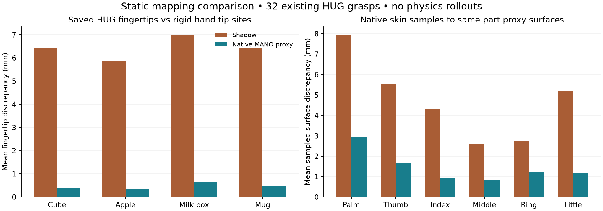

# HUG native MANO static comparison — 15 October 2026

## Result and accepted scope

Implemented an isolated MANO-derived articulated model and compared **all 32 existing saved HUG proposals**, eight each for cube, apple, milk box and mug, against their **literal saved Shadow commands** using the current source-accurate importer. No new HUG inference, proposal, fit, physics integration, evaluation episode, outcome label or training was performed.

Native pose reconstruction and skeleton import pass the numerical checks. The native collision approximation improves every anatomical part/case mean surface-distance measurement, but still changes some near-object relationships. **This accepts the tested native static kinematic import, not full collision fidelity or a physical execution path.** The default Shadow mapper, evaluation registry and historical criteria/results remain unchanged.

| Measurement on the same saved proposals | Native MANO path | Saved Shadow path |
| --- | ---: | ---: |
| Mean fingertip discrepancy from original skinned MANO tips (160 tips) | 0.453 mm | 6.428 mm |
| 95th-percentile fingertip discrepancy | 0.914 mm | 15.256 mm |
| Maximum fingertip discrepancy | 1.551 mm | 17.518 mm |
| Mean of 192 anatomical part/case surface-distance means | 1.463 mm | 4.727 mm |
| Maximum sampled native-centroid-to-component-surface distance | 11.892 mm | 30.165 mm |

Each surface mean first weights native triangle centroids by triangle area **within one anatomical part and case**. The table averages those 192 means equally; it is not a globally area-weighted whole-hand metric. These are finite, one-directional component-boundary measurements, not continuous Hausdorff bounds or exposed-union/contact certificates. Native is lower on all 192 means and all 32 per-case mean fingertip errors. The maximum native bone-position discrepancy from the upstream float32 calculation is **47.740 nm**.

## What was implemented

- `src/grasp_failure_prediction/evaluation/native_mano.py`: version `native_mano_static_capsule_hull_v1`; a free wrist and 15 ball joints, preserving the source-shaped MANO hierarchy and literal local rotations.
- `scripts/audit_hug_native_mano.py`: a separately frozen `prepare`/`run` audit of existing native parameters, saved Shadow commands and captured object geometry. Integration and retargeting calls are guarded to fail.
- `tests/test_native_mano.py` and `tests/test_native_mano_comparison.py`: 21 model controls and 12 distance/sampling controls, all passing. They use manufactured geometry, not new evaluation grasps.

Neutral geometry is reconstructed from the saved MANO shape. Each neutral vertex is assigned to its maximum-weight bone; each of 15 phalanges is approximated by a capsule from its proximal joint to its child joint (or native terminal tip). Its radius is the RMS distance of its assigned vertices to that bone's infinite axis. The palm is the convex hull of wrist-assigned neutral vertices. This geometry rule was fixed before measuring posed errors. All 32 proposals share one saved shape; this is not shape-generalization evidence.

The model has gravity and contact masks disabled, no controller/actuators, and placeholder inertias explicitly unsuitable for physical validation. `set_pose` invokes static `mj_forward` only. Small float32 rotation defects are explicitly projected to SO(3), with measured projection and quaternion conversion diagnostics. The model refuses invalid inputs and advanced-time states. There is no registration as a `grasp-eval` hand or outcome-producing runner.

HUG's paper describes a MANO-derived MuJoCo hand with phalanx capsules and a convex palm, alongside an execution protocol (§5.2, Appendix E.1). Its repository currently describes inference as the supported usage and lists simulation code as pending. Our geometry follows that high-level design, but its capsule sizing, articulation implementation and physical parameters are **not a reproduction of the unpublished simulator**. [HUG paper](https://arxiv.org/html/2606.17054v1#A5.SS1), [official implementation](https://github.com/KevinyWu/hug#release).

## Comparison method

The protocol binds the existing 32-case inventory, each native output and saved command, captured scene/camera/state/contract, MANO asset, source modules and Shadow meshes/URDF. Original native parameters reconstruct the saved 778 vertices, 21 landmarks and faces; all 32 comparisons pass. A numerical import allowance of 1 micrometre was frozen before measurement; it checks coordinate/rotation implementation precision and is **not a permissible physical or retargeting distortion**.

Native bone positions are compared with the upstream MANO skinning-layer transforms. The native model's terminal sites are rigid points on the distal bones. They are compared with HUG's original **skinned** fingertip vertices, so their residual includes pose-dependent skinning/blend-shape effects even with accurate skeleton import. Shadow fingertip positions use the source-accurate current hand and the saved nominal joint and root commands without optimization, clamping or controller changes. This compares two representations of the same saved sources; it is not a comparison against the best achievable Shadow retargeter.

For each part (palm, thumb, index, middle, ring, little), native faces are assigned by their summed grouped vertex skinning weights. Triangle-centroid distances to the corresponding simulator component boundaries are area-weighted within that part/case. Separately, 512 distinct deterministic object surface probes per case use area-quantile face selection and Halton barycentric coordinates. The same points query the native triangles and each hand approximation. Captured object visual triangles are preferred; the cube uses its captured collision geometry. Probe selection does not depend on either hand's errors. Reported p95 values are unweighted.

Distances are unsigned and may include component boundaries buried by overlapping parts. Native skin is partitioned by a declared ownership heuristic, not an anatomical ground-truth segmentation. No normal-direction or exposed-union certificate was computed. Source-to-proxy sampling is one-directional and does not bound outward protrusions or narrow unsampled discrepancies. The probe counts are correlated geometric observations, not independent grasps or statistical trials.

## Remaining proximity changes

The same historical 1, 2 and 5 mm bands are reported descriptively on the object probes. A lost flag means the original native part is within the band while the proxy is outside; an added flag is the reverse.

| Band | Native lost / added flags | Shadow lost / added flags |
| --- | ---: | ---: |
| 1 mm | 276 / 488 | 353 / 454 |
| 2 mm | 298 / 636 | 491 / 669 |
| 5 mm | 236 / 729 | 680 / 690 |

Counts sum over 32 cases × six parts × 512 probes for each band; native-near denominators are 499, 977 and 2,419 respectively. Native improves average geometric fidelity but does not improve every property: **it adds more 5 mm near flags (729 versus 690)** and more 1 mm flags. These pointwise diagnostics are not a rerun of the historical continuous-cell/sign-reversal acceptance study. No original failure is reclassified.

## Why validation has been difficult, and what this resolves

Three questions had been conflated:

1. **Does the simulator realize the specified coordinates and joints?** This is an implementation question, appropriately checked near numerical precision. The existing static Shadow command bridge already passed its scoped checks. The new native MANO skeleton also passes, with independent mathematical readback.
2. **Does a different hand preserve the original human skin and object relationships?** Different anatomy and collision approximations can change these even when every coordinate is correct. Zero changes at every narrow distance band and no surface reversal are stringent project-defined native-preservation conditions. They are not HUG's published universal Shadow-mapping standard. The earlier millimetre-scale counterexamples are real, not all numerical artifacts.
3. **Are the simulator and execution protocol adequate for failure prediction?** Neither accurate coordinates nor geometric agreement proves this. It requires a specified controller, contact/dynamic checks, preserved bad proposals, held-out inputs and later outcome-based sensitivity/generalization evidence.

The results support a concrete path forward: native skeleton import is solved on this fixed cohort; the next uncertainty is the collision approximation. They do not prove every strict native-surface criterion can be satisfied, or that a useful predictor is guaranteed. Finite failed optimization likewise did not prove global impossibility. The original checker also lacked a complete positive-certification route; this was diagnosed separately in [the acceptance repair](HUG_MAPPING_ACCEPTANCE_REPAIR.md), without erasing its valid negative witnesses.

Changing from common Shadow execution to native hands would change the study's outcome definition. If HUG/ContactGen use a human hand while other generators use Shadow, generator identity and hand embodiment can be confounded. This comparison adds a native reference path; it does not silently redefine the cross-generator experiment. A future multi-hand design would need hand/geometry-aware inputs and controlled comparisons, or a clearly limited claim about complete generator-to-execution pipelines.

## Next bounded step (proposed, not run)

Validate the native **exposed collision boundary** against the saved skinned surface around the existing objects, including surface directions, penetrations and sampling uncertainty. Freeze the geometry rule and prospective error budget independently of wanting these 32 development cases to pass. Where capsule/convex-palm approximation dominates, compare a more faithful source-derived collision decomposition under the same static protocol. The practical error budget should ultimately be justified by physical sensitivity or task accuracy, not selected retrospectively to admit the current cohort.

Only after geometric/model scope is accepted should a separately authorized stage specify mass/inertia, contact parameters, actuation, controller and tracking checks. Native-path dynamic validation, fresh inputs and dataset collection have not begun. Preserve poor native proposals: geometric validity is not successful lifting.

## Evidence, review and reproducibility

Archive: [`research_artifacts/hug_native_mano_comparison_2026-10-15_v1`](../research_artifacts/hug_native_mano_comparison_2026-10-15_v1/README.md).

- Frozen protocol SHA-256: `ddd895ade2ab03c9d48110693df472cc39425157ddbb9496ce7505962a982ea7`.
- Native model source SHA-256: `930e7652b53b2a5d64b2d170d830b74d3dce142dadb662ea758c44c8b4294a51`.
- Original strict criteria SHA-256: `87da8d6c03c0f5692f08cbad99f3af42f72f16d818b5b30df581791361d400d4`; unchanged.
- Independent reviewer checks all 32 against a separate scalar FK implementation: skeleton, rigid tips and capsule endpoints agree within 3.39×10⁻¹⁶ m; compiled palm vertex-set error is at most 3.67 nm. A-B-A repeatability, rigid-transform covariance and invalid-state controls pass. Its independent scalar summary confirms all 192 improvements and the remaining proximity changes.
- The original measurement saved all 32 case files, then its final summary export failed because a NumPy integer was not JSON serializable. The complete failure log and exact measured script remain archived. The aggregate was recovered from those scalar case files; **no geometry was rerun**. The production script differs only by an integer conversion in that aggregate field. Recovery verifies all frozen bindings, substituting the archived measured script for that source binding. The 97-forward count is reconstructed from completed control flow, not an exported live counter. Runtime versions were read during recovery; the distinction is recorded in `results.json`.
- The model's initial manufactured endpoint-order reporting defect was corrected before final measurements. It affected readback ordering, not capsule shape. Earlier independent test setup failures (missing optional trimesh search path) remain in the review archive alongside the passing run.

Reproduction requires the existing licensed MANO asset, saved private HUG outputs/captured scenes, and the pinned external HUG/MANO runtime identified by the protocol. They are hashed but not redistributed. No checkpoint or generator inference is needed. Use a **new diagnostic output directory** with `prepare`, then `run`; never overwrite this frozen archive. The current script's `--dependency-dir` options allow the existing runtime directories. Base NumPy/MuJoCo must load before the external dependency paths to avoid mixed NumPy installations. The archived original protocol remains tied to the archived original script, rather than being edited for the subsequent serialization repair.
