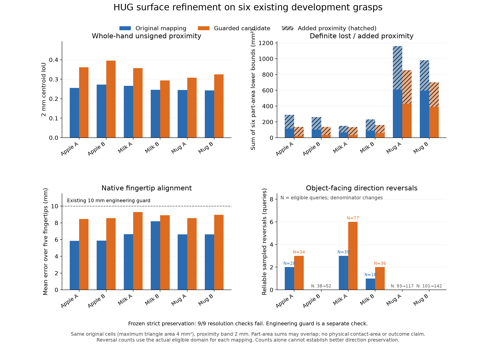

# HUG surface-aware mapping correction and validation

14 October 2026. Static development work on six existing HUG grasps, followed
by the same six surface checks and three finer repeats. No new HUG inference,
evaluation episode, physics integration, task label or predictor training ran.
The manuscript and frozen prediction model remain unchanged.

## Where we are

The numerical conversion is supported within its tested scope: native MANO
reconstruction, coordinates, named joints, limits, independent forward
kinematics and the declared wrist-to-palm placement. That does not make the
native and simulated grasp identical. HUG describes a human MANO hand; the
simulator uses a different Shadow Hand. The original mapper fits ten landmark
vectors and does not fit the native hand's surfaces relative to the object.

The failed strict check contains multiple anatomical proximity changes and
some reliable object-facing direction reversals. It is not evidence of one
remaining coordinate bug. No tested scale/frame or cross-case warm-state defect
was found to repair. Correct numerical conversion and approximate surface
geometry are separate findings.

## What was implemented

New explicit static research APIs at
`grasp_failure_prediction.evaluation.surface_refinement` and
`grasp_failure_prediction.evaluation.surface_refinement_guard` implement a
bounded, native-relative correction. They are experimental; the default
retargeter and `grasp-eval` do not invoke them.

The correction fits native anatomical unsigned distances and closest-point
vectors on fixed object-side queries. These retain the original proposal's
relationships, including poor ones, rather than rewarding extra contact,
removing every penetration or optimizing a successful lift. Fixed settings
include weak original-landmark/joint regularization, source-URDF limits and a
0.35 rad joint trust domain. A wrist stage precedes separate finger stages.

The native MANO wrist and Shadow palm **position** remain aligned. Palm
orientation follows the existing q-dependent operator/hand convention and
changes by 0.501–1.355 degrees; it is not fixed. Carrier translation only
compensates the changed wrist articulation. Object geometry, hand scales,
source inputs and carrier rotation are unchanged.

The original bounded solve reduced its fitting objective in all 36 stages but
exceeded the existing 10 mm mean fingertip guard on all six poses. Those raw
candidates are retained as refused diagnostic outputs. A separately frozen
common backtracking rule chooses the largest predefined joint interpolant
that respects the existing guard and improves the same full-pose objective.
It falls back to the exact original target when none qualifies. No proposal is
deleted, relabeled as physical failure, or given a case-specific weight.

[The frozen implementation report](../research_artifacts/hug_surface_refinement_2026-10-14/prototype/REPORT.md)
records every objective, configuration, stage, guard decision and version.
The API derivative adds input validation and protects callback arrays/audit
histories; it changes no objective/default/solver weights. Its 70 manufactured
tests and 11 exact frozen/API parity comparisons pass. Replaying the stored
engineering assessments also reproduces all six guarded targets and diagnostic
fields exactly; that replay does not recompute geometry. The six geometry
results belong to the frozen experiment modules, not an unmeasured API rerun.

## What the independent checks show

All six guarded poses meet the existing engineering limit, with mean fingertip
errors of 8.458–9.290 mm. Their frozen surface objective decreases 10.527–21.471%.
However, fingertip and middle-landmark errors worsen on every case relative to
the original mapper. An engineering guard pass is not a scientific mapping pass.

The independent audit uses the same native meshes, exact query cells, 1/2/5 mm
bands, per-part definitions, numerical allowances, nearest-feature eligibility
and frozen strict acceptance rule. It reconstructs actual final compiled
geometry and checks the root/joint/fingertip/interpolation conditions separately.

- Whole unsigned 2 mm proximity overlap improves on all six coarse cases:
  original IoU 0.243–0.273, guarded IoU 0.294–0.395. This includes carriers and
  is a centroid estimate, not physical contact overlap or an acceptance score.
- The sum of definite lost-area lower bounds across six separate anatomical
  parts decreases on all six cases. Part masks overlap; this sum is not unique
  object area. Some added relationships worsen: first milk-box added-area sum
  grows from 84.28 to 102.14 square millimetres.
- Reliable 2 mm sampled direction counterexamples remain. First apple changes
  from 2 reversals among 28 eligible queries to 3 among 34; first milk changes
  from 3/39 to 6/77; second milk changes from 1/18 to 2/36. Eligibility changes,
  so these counts alone are not a comparable direction-error rate. Finer cases
  also retain reversals. No continuous normal certificate is claimed.
- **Strict preservation still FAILS on all six cases and three finer repeats.**
  Rechecking the 178 original cell witnesses retains 65 definite counterexamples;
  13 cells now have definite equal band states and 100 remain unresolved. Losing
  a definite counterexample to uncertainty does not establish preservation.

For example, the original apple middle-finger 1 mm witness remains a definite
loss: native cell distance upper bound 0.937 mm, guarded mapped lower bound
1.226 mm on the same 1.038 square-millimetre cell. The centroid distance improves,
but the relationship still differs. Mug index and palm regions, and apple/milk
ring/little regions, identify concrete remaining work.

[The independent report](../research_artifacts/hug_surface_refinement_2026-10-14/validation/REPORT.md)
and [all-case summary](../research_artifacts/hug_surface_refinement_2026-10-14/validation/summary.json)
preserve every band, part, resolution and actual denominator, including
regressions. Distance-area bounds remain conditional on explicit arithmetic
allowances. Open native patches, individual mapped collider boundaries, buried
interfaces and unavailable native carriers retain their original measurement
scope; these are not exact solid/force comparisons.

## Decision and next step

Keep the default mapper unchanged. Retain this correction as an inspectable,
versioned development candidate; improved average fitting and engineering guard
passage do not justify promoting a candidate with retained/introduced strict
counterexamples. HUG remains the active mapping investigation before another
generator is treated as accepted.

A proposed next version would enforce fingertip alignment during a global
surface solve and explicitly fit reliable native-relative surface directions,
including native away-facing states. It must retain ties, inside/buried features
and missing relationships in the audit rather than optimizing away unavailable
evidence. The settings need to be frozen before another comparison. This is
proposed work, not a completed correction or proof that all relationships can
be represented by Shadow joint motions.

The current strict rule tests a stronger claim than useful approximate
retargeting: complete specified surface-relationship preservation across two
hand morphologies. No result here proves that such a mapping is globally
impossible. Equally, passing numerical tests cannot certify it. Independent
Lipschitz intervals can remain ambiguous on cells crossing a band boundary even
for identical distance functions; removing observed contradictions would still
need additional evidence for a full-domain PASS. The rule was not relaxed.

Physical-contact equivalence remains UNRESOLVED. Failure-label preservation,
independent unseen-object validation and predictor adequacy remain NOT_TESTED.
Future prediction results must state whether they concern the documented
mapped-Shadow execution pipeline or each generator's native embodiment. Static
mapper optimization is not predictor training, and no new eval collection or
model fitting was performed.
