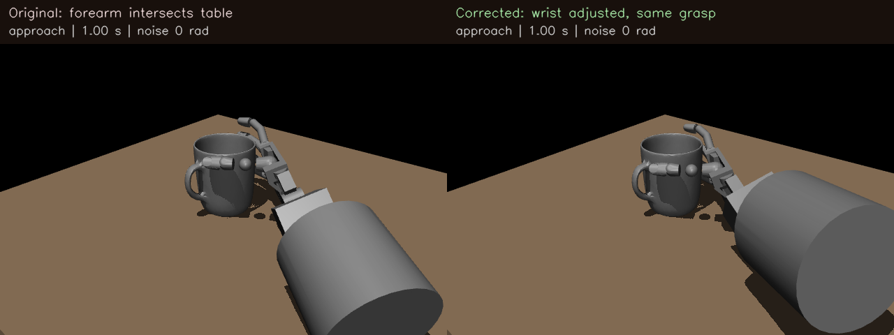

# Fixing the mug table collision

## What happened, in five steps

1. We replayed the saved mug attempts. The **forearm** hit the table during
   approach, before finger noise was applied. All eight original mug proposals
   placed part of the forearm 4.93 to 61.51 mm below the tabletop.
2. HUG supplies a human hand grasp. Retargeting matched the fingers, but the
   larger Shadow forearm also needed room. The old controller kept its wrist
   posture without checking whether that posture fit above the table.
3. We searched the two wrist joints within their limits and compensated the
   carrier position and orientation. The intended **world palm pose and all 22
   finger targets stay unchanged**. The nominal approach has at least 10 mm
   clearance above the tabletop.
4. We added a simulation guard. It checks actual hand geometry after every
   2 ms physics step. If any part enters a 1 mm table margin, execution stops
   and receives **no binary task label**. Noise, contact and tracking error can
   move actual fingers away from their commanded positions.
5. We ran a small regression before another collection. All eight baseline
   mug approaches cleared the table. Seven completed the grasp, lift and hold;
   one failed acquisition. A clean approach does not guarantee a good grasp.

Watch the [before/after replay](../research_artifacts/mug_table_clearance_v1/mug_before_after.mp4).
The left side shows the original forearm placement; the right side shows the
same HUG proposal with compensated wrist placement. Both use zero noise.



## What we checked

The final check planned 24 mug trials: eight saved proposals, each with requested
noise amplitudes 0, 0.15 and 0.60 rad. Each proposal used the same random direction
for its two nonzero amplitudes. We also ran cube, apple and milk carton controls.

Of the 27 planned checks, **26 completed with zero table contacts**: 22 successes
and four failed acquisitions. Within the mug subset, 23 completed: 20 successes
and three failed acquisitions. One high-noise mug trial was stopped by the guard
at 2.858 s, with the little finger still **0.946 mm above the table**. Its label
is null, and it has no completed result file.

An earlier diagnostic run without the runtime guard exposed that finger issue:
the little finger first contacted the table at 2.882 s, with a deepest penetration
of 0.612 mm. The original scorer only vetoes table contact during approach and
would still label this particular late contact as success. The new execution
gate stops it before contact; the task scorer remains unchanged.

The independent replay audit checks every physics step, not just the 40 ms saved
frames. Cube, apple and milk carton control trajectories reproduce the original
files byte for byte. Zero-noise action records can differ in signed zero bias
bits because their random seeds differ; physical commands and states are identical.
See the [audit report](../research_artifacts/mug_table_clearance_v1/final_dynamic_replay_audit.json)
and [planned checks and outcomes](../research_artifacts/mug_table_clearance_v1/summary.json).

The full test suite passed: **371 passed, 34 skipped**. The 33 new tests cover
geometry preservation, joint limits, state immutability, impossible poses,
protocol hashes, runtime rejection, and command exit codes.

## How to execute the corrected controller

Use the existing saved **v2 input case** with the new entry point. The entry point
validates its original observation, scene binding and fingertip fit, then records
the new execution protocol, `fixed_grasp_lift_v3_table_clearance`. Do not replace
the old case's registry ID manually: the legacy registry intentionally retains
the frozen v2 protocol.

```bash
python -m grasp_failure_prediction.evaluation.table_safe_execution \
  runs/fresh_object_scene_eval_2026-10-11/inputs_new_objects/cases/scene_002_seed_0.yaml \
  --project-root . --output runs/table_safe_mug_example \
  --noise-amplitude 0 --noise-seed 9000
```

This requires the existing evaluation runtime and saved scene/proposal assets.
On the current Mac, select that runtime with:

```bash
sim_source=/Users/nilakarthikesan/.codex/worktrees/partner-simulation-review/grasp-failure-prediction
sim_assets=/Users/nilakarthikesan/grasp-failure-prediction
export PYTHONPATH="$sim_source/src:$sim_assets/runs/hug_integration_check/hug-deps:$sim_assets/runs/hug_integration_check/deps:$sim_assets/runs/hug_integration_check/deps/cmeel.prefix/lib/python3.12/site-packages"
```

Use `$sim_assets/.venv/bin/python` for the commands below, passing
`--project-root "$sim_assets"` and a new output directory.

To reproduce the small validation and independently audit completed executions:

```bash
python scripts/validate_mug_table_clearance.py \
  --project-root . --output runs/mug_clearance_check
python scripts/audit_mug_table_clearance.py \
  --run runs/mug_clearance_check \
  --original runs/fresh_object_scene_eval_2026-10-11/collection_2080 \
  --report runs/mug_clearance_check/dynamic_replay_audit.json
```

The [rejection auditor](../scripts/audit_mug_clearance_rejection.py) separately
checks the stopped snapshot against a matching diagnostic execution's model and
commands. For this recorded experiment, use
`final_checks_27/mug_scene003_seed3_noise0.60` as `--rejected` and
`checks_27/mug_scene003_seed3_noise0.60` as `--reference`, under the local
`runs/mug_table_clearance_validation_2026-10-11` directory. Its 20 checks passed;
the [saved reproduction check](../research_artifacts/mug_table_clearance_v1/rejection_reproduction_check.json)
records the first margin crossing and confirms no contact through that point.

Static rejection has status `clearance_rejected`; an actual motion margin
violation has status `runtime_clearance_rejected`. Both have `label: null`.
The single-case command exits with code 2 for either rejection. Completed
executions alone receive the unchanged 1 = success / 0 = failure label.

## Where the evidence is stored

The compact [repository evidence bundle](../research_artifacts/mug_table_clearance_v1/)
contains the diagnosis, final checks, audit, rejection record, protocol and
before/after videos. Raw simulator models, actions and states remain locally at:

```text
/Users/nilakarthikesan/grasp-failure-prediction/runs/mug_table_clearance_validation_2026-10-11/final_checks_27
```

Each completed trial contains `actions.npz`, `trajectory.npz`, `scene.mjb`,
`result.json`, `resolved_case.json`, `events.json` and `collection_metadata.json`.
Metadata records original and adjusted wrist angles, world palm targets, clearance
measurements, noise settings, protocol hash, source hashes, original case hash
and runtime versions. The stopped trial contains metadata and its diagnostic
`runtime_guard_state.npz`, without a completed outcome.

To open the compact before/after examples in the existing viewer:

```bash
python -m grasp_failure_prediction.evaluation.result_viewer \
  --runs-root research_artifacts/mug_table_clearance_v1/examples \
  --port 8771 --no-open
```

Then use the [local viewer](http://127.0.0.1:8771/) while the server is running.

## Scope and the next collection

This is a controller correction and development regression. It is not a new
predictor evaluation or evidence of generalization to unseen objects. Original
model weights, scaling, threshold, task scorer and historical v2 records are
preserved. These corrected v3 checks must not be passed to the historical frozen
evaluation as though its controller were unchanged.

The planner checks an infinite horizontal table plane, which conservatively
rejects low geometry even outside the finite tabletop. It supports vertical
descent. The search is bounded and deterministic; rejection means no candidate
on that search satisfied the policy. Proximal object separation is checked at
the nominal endpoint. A separate 41-position sweep found no proximal object
contacts along these eight mug approaches, but that is not a general certificate
for other objects or approach paths. The runtime guard uses privileged simulator
geometry and does not establish a physical robot safety system or recovery policy.

The next batch should explicitly use the v3 execution API, record rejected
attempts separately, and preserve execution-version grouping. Freeze that batch
before testing the unchanged predictor. Count and report rejections rather than
silently discarding them. The larger collection has not been started here.

## Subsequent frozen model diagnostic, 12 October

The 26 completed checks above have now been scored with the unchanged saved
predictor, original input contract and 0.5 failure alert threshold. All 23
completed mugs were flagged, including all 20 successful grasps: 7/7 successful
zero noise attempts, 8/8 at 0.15 rad and 5/5 at 0.60 rad. The three actual mug
acquisition failures were also flagged. The one runtime guard rejection remains
unscored with a null outcome; it stopped before the input cutoff.

The [diagnostic record](../research_artifacts/corrected_mug_model_diagnostic_v1/README.md)
contains scores, grouped results, the rejection, causal inputs and an independent
audit. This uses the existing controller development recordings and does not
start a new collection or replace the unchanged historical v2 evaluation.
The controller correction results above and original recording files are
preserved. The repeated false alarms motivate a separate input distribution
and safe wrist coverage investigation before an expanded evaluation.

## Note for the paper

The fresh-object experiment exposed an embodiment feasibility problem: all mug
proposals collided with the table through proximal forearm geometry before
disturbances were applied. We introduced a separately versioned wrist redundancy
planner that preserves the intended world palm and finger geometry, together
with a per-physics-step table clearance gate. A small regression resolved the
forearm approach collisions; one disturbed closure was rejected before table
contact. This correction separates controller infeasibility from subsequent
grasp acquisition failure. Its development results should be reported separately
from the historical frozen-model evaluation.
