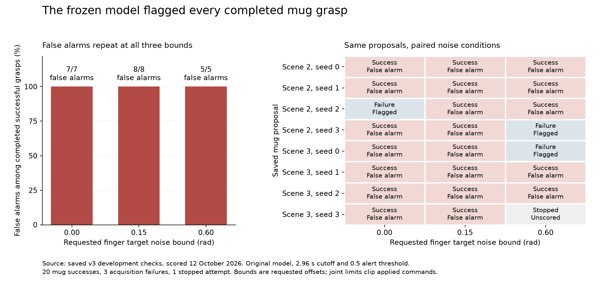

# Frozen model scoring of the corrected mug checks

12 October 2026. We scored all **26 completed recordings** from the existing
corrected controller checks with the original saved model. We kept its weights,
training normalization, 2.96 second input cutoff and 0.5 failure alert threshold
unchanged. We ran no new simulation and performed no training or threshold tuning.

**The model alerted on every completed mug attempt: all 20 successful grasps
were false alarms, and all three failed acquisitions were detected.** The one
stopped attempt remains separate, without a success/failure label or prediction.



## What we did, step by step

1. Used the original declared 27 checks: 24 planned mug attempts plus a cube,
   apple and milk carton control. The mugs share two observation families and
   eight grasp proposals. Each proposal has paired runs at three noise bounds.
2. Retained the 26 completed recordings. One mug was stopped by the runtime
   table clearance guard, before a complete prediction input was available.
3. Copied only the 20 closing samples from 2.20 through 2.96 seconds for each
   completed recording. Inputs are 24 joint positions, 24 joint velocities and
   24 applied joint targets per sample, in the original model's joint order.
   The model summarizes these with its existing statistics and normalization.
   The first lifting sample is at 3.00 seconds.
4. Generated all predictions from those observable inputs before reading the
   completed outcome files for comparison. Outcome labels, contact events,
   object truth, noise settings and future motion were not predictor inputs.
   This is offline scoring of saved motion, not a live controller intervention.
5. Compared the predictions with the original task labels: **1 = successful
   grasp, lift and hold; 0 = failed task**. An independent calculation reproduced
   every prediction within 1.11e-16 and checked all grouped results and hashes.

## Do the false alarms repeat across noise levels?

Yes. Each successful mug triggered a failure alert at the existing threshold:

* **0.00 rad:** eight completed; seven successes and one failure. False alarms
  on **7/7 successes**; the one actual failure was also flagged.
* **0.15 rad:** eight completed; all successful. False alarms on **8/8 successes**.
  There are no actual failures here, so failure recall and AUROC are undefined.
* **0.60 rad:** seven completed; five successes and two failures. False alarms
  on **5/5 successes**; both actual failures were flagged. One additional attempt
  stopped and was not scored.

These are requested bounds on a fixed random finger command bias for each
attempt. Joint limits can clip the applied targets. Wrist noise is zero in
this collection. More noise does not automatically mean failure; the executed
grasp determines the label.

For example, **mug_scene002_seed2** failed with zero noise and succeeded at
both 0.15 and 0.60 rad. Its failure scores were near 1.0 in all three cases,
so its improved physical outcome did not clear the alert. Conversely,
scene002 seed3 and scene003 seed0 succeeded at the two lower bounds and failed
at 0.60 rad. The saved CSV contains every prediction and outcome.

Across the 23 completed mugs, failure scores ranged from 0.6700 to nearly 1.0.
All were above 0.5. The success false alarm rate is 20/20 and the actual failure
detection rate is 3/3; alerting on everything produces both of these numbers.
Failure alert precision and overall mug accuracy are each 3/23, or 13.0%.
The scores are not calibrated physical failure probabilities. Ranking metrics
in the JSON report do not repair the threshold behavior: the zero noise AUROC
of 1.0 is based on only one failure.

The three controls were: successful cube correctly cleared (failure score
0.0443), failed apple correctly flagged (0.8549), and successful milk carton
falsely flagged (0.6085). Across all 26 recordings there were 21 false alarms,
four detected failures, one correctly cleared success and zero missed failures.

## The stopped attempt

**mug_scene003_seed3_noise0.60** was stopped at about 2.858 seconds, before
the 2.96 second prediction cutoff. Its little finger geometry reached about
0.946 mm above the table, inside the required 1 mm clearance margin. This is
a controller guard rejection. It has no completed task result, eligible full
prediction prefix, success/failure label, failure score or alert. These fields
are null in [excluded.json](excluded.json). We did not fill in missing motion
or count it as a failed grasp.

## What this changes in our plan

The earlier single mug false alarm now repeats across all three command noise
conditions. At its current threshold, this model does not reliably distinguish
successful mugs from failed mugs under the corrected execution setup. Merely
adding this same kind of noise does not demonstrate that the predictor transfers.

The earlier [single grasp score attribution](../mug_single_walkthrough_v1/score_attribution.json)
suggested shifted wrist inputs as a possible contributor. This diagnostic does
not isolate the cause or establish that removing wrist features would fix it.
The next development comparison should examine input distributions and safe
wrist coverage with matched controls, then declare a fresh evaluation before
claiming improved transfer. No such model change or further collection is part
of this result.

These are reused controller development checks: two mug observation families,
eight related proposal families, paired noise draws and a changed v3 controller.
They are not an untouched object generalization benchmark or independent trials
of a live warning system. The target is eventual task outcome, not physical
slip onset, warning lead time or recovery. The manuscript retains its earlier
quantitative pilot scope; this diagnostic is documented separately.

## Evidence and reproduction

* [plan.json](plan.json): selection, fixed model contract, source hashes and code revision recorded before inference.
* [predictions.csv](predictions.csv): all 26 scores, original labels and classifications.
* [report.json](report.json): overall, mug and per noise results, controls and scope.
* [excluded.json](excluded.json): the stopped attempt with null prediction and label.
* [prediction_inputs](prediction_inputs/): observable closing prefixes only.
* [dataset.npz](dataset.npz): exact float32 input vectors and separate outcome labels.
* [independent_audit.json](independent_audit.json): independent probability, metric, prefix and hash checks.
* [manifest.json](manifest.json): portable payload inventory and original source/model hashes.
* [noise_false_alarms.svg](noise_false_alarms.svg): exportable figure.

All 238 original raw files and the four frozen model, report and prediction
source files were unchanged. Full motion, noise metadata and guard state remain
at the existing local source directory:

```text
/Users/nilakarthikesan/grasp-failure-prediction/runs/mug_table_clearance_validation_2026-10-11/final_checks_27
```

From an environment with this repository installed, reproduce a portable score:

```bash
python -m grasp_failure_prediction.prediction.model \
  --model research_artifacts/task_outcome_baseline_v1/proprioception_and_commands.npz \
  --episode research_artifacts/corrected_mug_model_diagnostic_v1/prediction_inputs/mug_scene002_seed2_noise0.15
```

To score the original checks again, choose a new output directory:

```bash
python scripts/score_mug_clearance_checks.py \
  --runs-root /Users/nilakarthikesan/grasp-failure-prediction/runs/mug_table_clearance_validation_2026-10-11/final_checks_27 \
  --output /tmp/corrected_mug_diagnostic_reproduction
```

The optional `scripts/plot_mug_model_diagnostic.py` reads saved scores and
results with Matplotlib; it does not load or change the model. It also refreshes
the payload manifest after saving the charts:

```bash
python scripts/plot_mug_model_diagnostic.py \
  --diagnostic /tmp/corrected_mug_diagnostic_reproduction
```

The independent audit checked the scoring payload before this explanatory
README and audit file were added. Its checked file inventory is retained in
`audited_scoring_files_sha256` in the final manifest; `files_sha256` covers the
complete packaged bundle.
