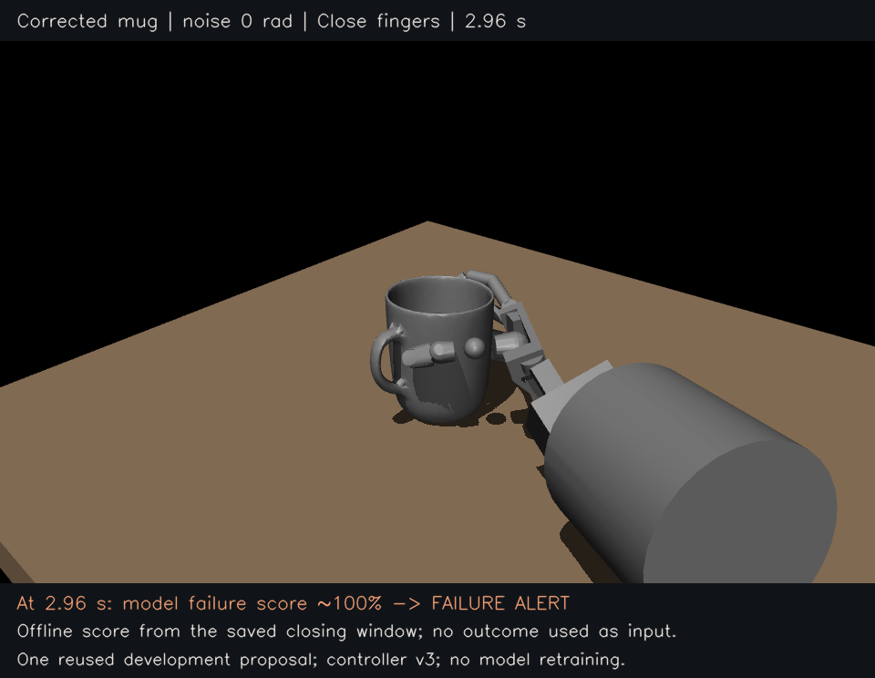
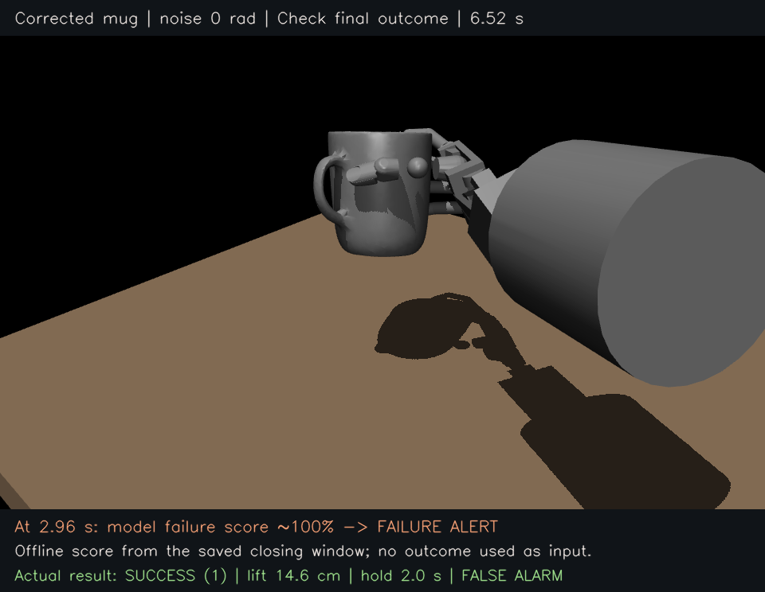

# One corrected mug grasp and a false alarm

Recorded on 12 October 2026. One zero noise attempt succeeded, while the
unchanged task outcome model raised a failure alert. This is a development
walkthrough using an existing mug proposal, not an independent test benchmark.

## What happened, step by step

1. We selected the first saved mug case, `scene_002_seed_0.yaml`, before running
   this attempt or viewing its prediction. This input was already used during
   controller development. The [plan](plan.json) was saved before execution.
2. The corrected `fixed_grasp_lift_v3_table_clearance` controller adjusted the
   wrist and carrier to clear the table while preserving the intended world
   palm pose and finger targets. No random finger angle bias was added. All saved
   requested and applied noise values are exactly zero.
3. We recorded the approach and closure. At the 2.96 second cutoff, the model
   uses the final twenty closing samples, from 2.20 to 2.96 seconds: hand joint
   positions, velocities and commanded targets. Lifting starts at the 3.00
   second sample. The [prediction input](prediction_input/) contains only
   whitelisted observable arrays through the cutoff, with no outcome files.
4. We loaded the original model, normalization and 0.5 failure alert threshold.
   The [prediction](prediction.json) is `p_failure = 0.9999999784968061`, producing
   a failure alert. This score is not a calibrated physical failure probability.
5. The simulated hand acquired the mug, achieved a maximum lift of
   **0.1460765141 m**, and satisfied the **2.0 second sampled hold** requirement.
   The unchanged scorer assigned **success = 1**. The alert is a false alarm.
6. A separate replay reproduced every saved position, velocity and integration
   state bit for bit. It checked all **3,260 physics substeps**, finding no
   hand contact with the table in any phase. See [the audit](dynamic_replay_audit.json).

The prediction was computed offline from the saved causal closing prefix after
the rollout finished. The model neither saw the completed outcome as input nor
controlled the hand. No weights, scaling, threshold or feature definitions were
changed. Their before and after hashes match in [the summary](summary.json).

Watch [the annotated replay](walkthrough.mp4). Its final two seconds pause on
the recorded outcome; they are display frames, not additional simulation.





## Why this frozen model raised an alert

The correction made the wrist posture physically feasible, but the predictor's
original training set had a narrow range of wrist configurations. One corrected
wrist command is **+0.0991 rad**, compared with approximately **−0.2039 to
−0.1764 rad** in the training feature range. Eight wrist features are more than
five training standard deviations from their training means.

In this linear model, wrist inputs account for **80.0% of the absolute feature
contributions**. Their net contribution to the success logit is **−18.5171**;
all other joint inputs contribute **+1.4581**, with intercept **−0.5961**.
The summed success logit is **−17.6551**, reproducing the saved probability.
See [the feature attribution](score_attribution.json) for named inputs, training
ranges, coefficients and source hashes.

This explains the arithmetic behind this particular false alarm. It supports
testing a controller and input distribution shift hypothesis. It does not prove
physical causation or establish that removing wrist features will solve transfer.
No alternative model was fitted, masked or selected using this example.

To reproduce the score explanation from repository artifacts:

```bash
python research_artifacts/mug_single_walkthrough_v1/analyze_score.py
```

That script validates the original dataset and model, reads this causal prefix,
and prints the attribution. It performs no training or writes.

## Storage and reproduction

This bundle preserves the plan, causal input, prediction, outcome, corrected
controller metadata, audit, attribution, replay and [file manifest](manifest.json).
The full simulation recording and render helper remain locally at:

```text
/Users/nilakarthikesan/grasp-failure-prediction/runs/mug_single_walkthrough_2026-10-12
```

Use the runtime described in [the mug correction guide](../../docs/MUG_TABLE_CLEARANCE.md).
To reproduce execution, use a fresh output directory and the original saved input:

```bash
python -m grasp_failure_prediction.evaluation.table_safe_execution \
  runs/fresh_object_scene_eval_2026-10-11/inputs_new_objects/cases/scene_002_seed_0.yaml \
  --project-root /Users/nilakarthikesan/grasp-failure-prediction \
  --output /path/to/new_mug_attempt \
  --noise-amplitude 0 --noise-seed 9000

python -m grasp_failure_prediction.prediction.model \
  --model research_artifacts/task_outcome_baseline_v1/proprioception_and_commands.npz \
  --episode /path/to/new_mug_attempt
```

## What this changes about the next experiment

The table correction works for this attempt; the existing predictor still needs
evaluation under the corrected execution conditions. Before retraining, declare
a small v3 batch with familiar object controls and new scenes, keep the model
fixed, and record false alarms, missed failures and guard rejections separately.
An input representation comparison belongs on development data, followed by
an untouched evaluation after the alternatives are frozen.

We propose asking Irmak which controlled experiment would best distinguish
grasp risk from object or wrist configuration effects. That advice has not yet
been received. Early warning time, recovery benefit and physical transfer remain
separate research questions.
