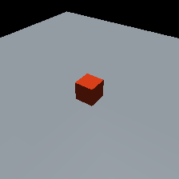

# Phase 1 scene-preparation fixture — 28 October 2026

This is a synthetic software-check fixture, separate from earlier HUG/Shadow
or native-MANO experiments. The user approved the 5 cm cube, 100 g mass,
sliding friction 1.0, gravity settling and fixed 224 by 224 camera baseline.

Implementation commit: `35ccb7ff62059ce024b89d48a9f21f1c4dbc80ab`. [Receipt](receipt.json) binds the source,
configuration, preview and [validation report](validation_report.json).
The complete editable XML and integration state remain in the local run folder
documented in the [walkthrough](../../docs/PHASE1_SCENE_PREPARATION.md).

Forty-one focused scene/observation tests passed. The capture independently checks
geometry, depth, camera projection and same-runtime reload consistency. No hand,
HUG inference, grasp episode, training or prediction is included. Numerical
tolerances and physical properties are explicit engineering assumptions.
