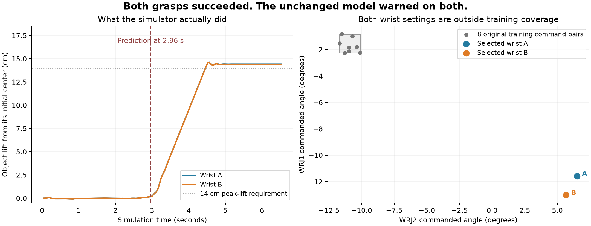

# One mug grasp, two safe wrist configurations

12 October 2026. **Both new zero-noise grasps succeeded, and the unchanged model
warned on both.** This is the first declared development pair, not an improved
model, a fresh object benchmark or a recovery experiment.



[Watch the side-by-side replay](wrist_pair_replay.mp4). Its displayed scores are
rounded; both are near 1, rather than exactly 1. These are uncalibrated model
scores, not measured physical probabilities. Predictions were computed offline
from saved earlier inputs; they did not control or stop either grasp.

## What happened, step by step

1. **Keep the intended grasp fixed.** Use the same mug, captured scene, HUG
   proposal, object mass, reset, timing and all 22 finger targets. Compensate
   carrier placement so the intended world palm and finger path stay the same.
2. **Choose two safe wrist commands before running.** A is the nearest eligible
   candidate to the original training wrist command distribution in a declared
   finite geometry search. B is the existing corrected wrist. Require at least
   0.02 rad combined command separation, 10 mm nominal table clearance and
   1 mm proximal object clearance. Neither candidate is selected using model
   scores or new outcomes. Both remain outside training ranges.
3. **Execute the first eligible pair in the declared order.** A new explicit v4
   executor honors each frozen setting and rejects substitution. It retains the
   same task dynamics and checks the actual 1 mm table margin every 2 ms. Run
   A and B once each with zero finger and wrist noise. Both complete; no guard
   stops or hand/table contacts occur.
4. **Ask the original model using only earlier robot inputs.** Each prediction
   uses 20 closing samples from 2.20 through 2.96 seconds: 24 joint angles,
   24 velocities and 24 applied targets. The first lifting sample is at 3.00 s.
   We retain weights, normalization, feature summaries and the 0.5 alert rule.
   Both predictions are saved before outcome files are read for comparison.
5. **Compare the warning with what the hand actually did.** Success is the
   existing grasp/lift/hold label 1; an alert on a successful task is a false
   alarm. A lifts 14.6208 cm and B 14.6077 cm. Both satisfy the two-second HOLD
   requirement. Both predictions are false alarms.

## Exact comparison and result

The selected proposal is `mug_scene002_seed0_noise0.00`. Wrist values use the
joint coordinate convention; they are not global camera or palm angles.

* **A:** WRJ2 +0.1136282552 rad, WRJ1 −0.2020766563 rad.
  Nominal table clearance 10.062933 mm. Training-scaled command distance
  39.198195. Failure score 0.9999999871415051; success logit −18.169261.
  Wrist contribution −19.046195; nonwrist contribution +1.473015.
* **B:** WRJ2 +0.0990838385 rad, WRJ1 −0.2268021563 rad.
  Nominal table clearance 10.003215 mm. Training-scaled command distance
  39.264660. Failure score 0.9999999784968061; success logit −17.655064.
  Wrist contribution −18.517097; nonwrist contribution +1.458114.

The command difference has Euclidean length 0.028686 rad. Per-joint changes are
approximately +0.833 degrees for WRJ2 and +1.417 degrees for WRJ1 in A relative
to B. A is slightly nearer training in this declared distance, but remains far
outside it and gives the higher failure score. Training distance is not the
model's learned decision function.

The B-minus-A success-logit change is **+0.514197**: wrist terms change by
**+0.529098**, nonwrist terms by **−0.014901**, with the same intercept. This
measures the existing score arithmetic. Both scores remain far beyond the alert
threshold. A probability saturated near 1 can hide an appreciable logit change;
unchanged alerts do not mean the inputs have no effect.

## What the independent checks establish

The independent audit reconstructs the 1,440-value prefixes and all 288 temporal
statistics, reproduces original training-only normalization, and hand computes
probabilities and coefficient contributions within 1e−12. Both arms have eight
active wrist features outside their training ranges. All 22 applied finger
command histories are bitwise equal across arms; requested and applied noise
are numerically zero. Wrist commands match frozen targets within 2.78e−17 rad
rounding, inside the declared 1e−12 reproduction tolerance.

Nominal world palm/finger paths agree within 1.67e−16 m. Actual contact dynamics
are measured separately over 163 saved endpoints: maximum A/B palm position
difference 0.05890 mm, maximum finger geometry difference 0.35723 mm, and maximum
palm orientation difference 0.001632 rad. These small differences are real;
nominal invariance is not a claim of identical physical trajectories.

Independent replay checks all 6,520 physics substeps across both completed arms.
All recorded qpos, qvel and integration states reproduce bitwise, with no
hand/table contact. B reproduces the prior zero-noise v3 motion: its trajectory
file is byte-identical and commands/states match. Disabled-noise signed-zero
arrays differ with the recorded seed; they have no nonzero disturbance.

## Interpretation and next step

This pair shows that the fixed model can give false warnings on two successful
executions of the same intended grasp. Wrist terms change the score, but this
small comparison does not clear the warning. Both wrist settings are unfamiliar,
so it does not test a familiar-versus-unfamiliar contrast, identify every cause
of model error, or show that training on wrist variation helps.

No failures occur in this pair, so failure recall and AUROC are undefined.
Do not pool these two new v4 attempts with the old 23 v3 checks as independent
generalization evidence. Only this first pair is executed; the seven other
selected pairs remain pending. Review this example, then use the remaining
declared pairs to check repeatability before deciding on the matched training
comparison. Do not increase finger noise or change the model based on this
example alone.

## Evidence, storage and the audit amendment

* [plan.json](plan.json) preserves the declaration before execution.
* [pose_manifest.json](pose_manifest.json) is the unchanged selection snapshot;
  its source bundle is [wrist_pair_selection_v1](../wrist_pair_selection_v1/README.md).
* [report.json](report.json), [predictions.csv](predictions.csv) and
  [predictions_before_outcomes.json](predictions_before_outcomes.json) preserve
  original scoring and the order of analysis.
* [prediction_inputs](prediction_inputs/) and [dataset.npz](dataset.npz) contain
  only causal model inputs, with labels stored separately.
* [independent_audit.json](independent_audit.json),
  [morphology_tracking.npz](morphology_tracking.npz) and
  [B_v3_motion_compatibility.json](B_v3_motion_compatibility.json) record checks.
* [audit_code_amendment.json](audit_code_amendment.json) discloses that the audit
  script was still being finalized when its hash was included in the original
  declaration. Later analysis adds independent geometry/tracking checks and
  uses the already-declared tolerance for floating-point command comparisons.
  Only that auditor hash is excepted. The original plan, model, executor, scorer,
  inputs and recordings are unchanged. The exact
  [historical auditor](historical_audit_wrist_pair.py) is retained for review.
* [scoring_manifest_at_inference.json](scoring_manifest_at_inference.json)
  retains the original scoring inventory; [manifest.json](manifest.json)
  describes the complete package after audits and replay media were added.
* [scoring_reproduction.json](scoring_reproduction.json) records an actual
  isolated-checkout rerun with the declared historical auditor. The original
  report, prediction CSV, dataset and pre-outcome prediction record reproduced
  byte-for-byte. The active source checkout was not changed for that rerun.

Full new recordings remain at:

```text
/Users/nilakarthikesan/grasp-failure-prediction/runs/wrist_pair_diagnostic_2026-10-12/first_pair
```

To reproduce the independent prediction, geometry and dynamic replay checks
with the existing source runtime and original raw recordings:

```bash
python -B scripts/audit_wrist_pair.py \
  --runs-root /path/to/first_pair \
  --pose-manifest research_artifacts/wrist_pair_selection_v1/pose_manifest.json \
  --scores research_artifacts/wrist_pair_diagnostic_v1 \
  --audit-code-amendment research_artifacts/wrist_pair_diagnostic_v1/audit_code_amendment.json \
  --output /tmp/wrist_pair_reproduction
```

Use a new output directory. The original scoring command checks the declaration's
historical auditor hash too. To rerun that exact original scorer, use an isolated
source checkout with `historical_audit_wrist_pair.py` copied to
`scripts/audit_wrist_pair.py`; restore the current auditor there before applying
the disclosed amendment. Do not replace files in the active checkout. The
current independent auditor reproduces the same model outputs directly.

Replay video and figures are retrospective visualizations of saved data, not
additional grasp attempts or model inputs. Slip onset, actionable warning time,
recovery and real robot transfer are not measured by this diagnostic.
