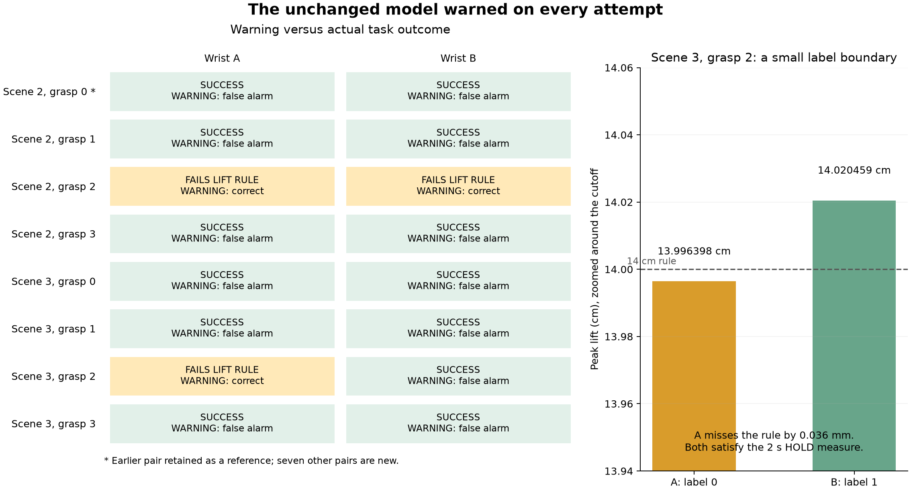

# Seven remaining wrist comparisons: false alarms repeat

12 October 2026. All **14 new attempts** completed with **zero noise**, the
exact previously selected wrist targets and the original model unchanged.
The model warned on every attempt: **11 successes were false alarms and three
completed task failures were correctly flagged**. No guard stops occurred.

Including the preserved first pair gives **eight pairs, 16 attempts, 13
successful false alarms and three detected task failures**. The first pair
was not run again or modified. These are related development grasps on one mug
in two scenes, not an independent object-generalization benchmark.



## What we did, step by step

1. Retain the [frozen eight-pair pose selection](../wrist_pair_selection_v1/README.md).
   Run the seven remaining proposals in their original order, A then B, once
   each. Preserve the same object, scene, finger targets, intended world palm
   path, controller timing, physics and task scorer. No candidate or attempt
   is replaced after seeing a score or outcome.
2. Use the existing explicit v4 executor, with zero finger and wrist noise.
   It verifies exact poses and refuses automatic wrist substitution. The
   actual table-clearance guard remains active every 2 ms.
3. Freeze the completed scoring and independent audit code before inference.
   Use the original model weights, normalization, 20 closing samples through
   2.96 s and the 0.5 failure-alert rule. Only joint positions, velocities and
   applied commands enter the model. Initial lift samples begin at 3.00 s.
4. Save all 14 predictions before opening task-result files for comparison.
   This is offline causal-prefix scoring; warnings do not control the grasps.
5. Compare predictions with the unchanged grasp/lift/hold labels, then verify
   the probabilities, commands, physical motion and recorded outcomes
   independently. Stopped attempts would remain unlabeled and unscored; none
   occurred here. The older stopped high-noise v3 attempt remains separate.

## Do the false alarms repeat?

Yes. Among the seven new pairs:

* **Five pairs succeed in both settings.** Both A and B warn in every pair:
  ten successful false alarms, with no alert clearing.
* **One pair fails the task rule in both settings:** scene 002, seed 2.
  Both warnings are correct detections. Peak lifts are 13.039952 and
  13.023149 cm, below the 14 cm requirement; both satisfy the 2 s HOLD measure.
* **One pair has different task labels:** scene 003, seed 2. A fails the lift
  rule and B succeeds. Both warn, giving one correct detection and one false
  alarm. This pair is not included in the both-success comparison.

That gives 11/11 false warnings among new successes and 3/3 detected failures.
Including the first pair gives six both-success pairs, all warning at both
settings, plus one both-failure pair and one A-failure/B-success pair.
The model behaves like an always-warn rule at its fixed threshold on these
cases. Detecting three failures while warning on every success does not show
that the warning system is reliable.

## Why did one label change?

Scene 003, seed 2 is very close to the frozen lift cutoff:

* **A:** peak lift 13.996398 cm, **0.036021 mm below** the 14 cm requirement.
* **B:** peak lift 14.020459 cm, **0.204587 mm above** it.

Their peak lifts differ by only 0.240608 mm. Both establish qualifying contact
and satisfy the existing two-second HOLD measure. The original labels remain
0 and 1. A scorer-defined `failed_acquisition` here means missing the lift
cutoff; it does not show loss of contact, a slip, a drop or a dramatic recovery.
Do not change these labels to produce a desired result. Any alternative task
or boundary-sensitivity analysis needs an explicitly separate version.

## What changes in the model scores?

Wrist changes move the logits, but no pair crosses the 0.5 alert threshold.
In the five new both-success pairs, B-minus-A success-logit changes range
from −0.526310 to +0.549436. Wrist terms account for most of those paired
arithmetic changes; finger response terms also change. Scores often saturate
near 1, so logits remain useful even when the displayed probabilities look
the same. Neither A nor B is within the original wrist-command ranges.
A is nearer the original command distribution in only three of all eight
selected pairs. Distance to training is not the learned decision function.

The descriptive failure AUROC is 0.9091 for the new 14 attempts and 0.8974
for all 16. These rankings use only three failures from two proposal families,
including one cutoff-adjacent label. They do not establish population
reliability or justify choosing a new threshold from these diagnostic cases.
The model's scores are not devoid of information; its present alert threshold
fails to distinguish successful executions usefully in this development batch.

## Independent checks and what they do not prove

The independent auditor reconstructs the whitelisted prefixes and manually
computes probabilities and coefficient contributions. Original normalization
from 520 training episodes reproduces bitwise; maximum probability discrepancy
is 1.39e−17. Model bytes and 479 bound source/payload files remain unchanged.
All disturbances are zero, wrist commands match their frozen targets within
1e−12, and the 22 applied finger-command histories are identical within pairs.
Nominal world palm/finger paths remain invariant.

Actual motion is measured separately. In the shared closing window, maximum
paired palm position difference is about 0.458 mm and finger-geometry
difference about 4.116 mm; the largest is in the both-failed scene 002 seed 2
pair. Identical intended geometry does not imply identical contact dynamics.
Per-phase tracking is retained for every pair.

All 45,640 physics substeps for the new recordings independently replay with
bitwise-identical qpos, qvel and integration states and no hand/table contacts.
Every B trajectory reproduces its earlier zero-noise v3 reference. Only
signed-zero representation in disabled-noise arrays differs. New execution
does not make those already inspected B conditions new independent evidence.

These results establish repeated false warnings under the frozen decision
rule. They do not identify every cause, show that more wrist training helps,
or measure physical slip onset, useful warning time, recovery or real transfer.

## Storage, evidence and reproduction

Full new recordings remain at:

```text
/Users/nilakarthikesan/grasp-failure-prediction/runs/wrist_pair_diagnostic_2026-10-12/remaining_pairs
```

The [original first-pair bundle](../wrist_pair_diagnostic_v1/README.md) and its
raw recordings are unchanged. This new package contains derived causal inputs
and audit evidence, rather than all simulator assets or full raw motion.

* [plan.json](plan.json) is the unchanged pre-execution seven-pair inventory.
* [pose_manifest.json](pose_manifest.json) preserves the exact original poses.
* [scoring_declaration.json](scoring_declaration.json) binds finished analysis
  code before inference; no new audit-code exception is needed for this batch.
* [report.json](report.json), [predictions.csv](predictions.csv) and
  [predictions_before_outcomes.json](predictions_before_outcomes.json) preserve
  new scores, paired results and separate remaining-seven/combined-eight counts.
* [dataset.npz](dataset.npz) and [prediction_inputs](prediction_inputs/) contain
  the exact causal model inputs, with labels stored separately.
* [pairs](pairs/) contains each pair's plan, score report, input export and
  retrospective morphology tracking.
* [independent_audit.json](independent_audit.json) records manual scores,
  invariant commands, source verification and full-step replay.
* [scoring_manifest_at_inference.json](scoring_manifest_at_inference.json)
  preserves the original scoring inventory; [manifest.json](manifest.json)
  covers the complete package after documentation and figures are added.
* [scoring_reproduction.json](scoring_reproduction.json) records a separate
  rerun whose report, prediction CSV, dataset and pre-outcome predictions match
  the original scoring byte-for-byte.

The new [execution wrapper](../../scripts/run_remaining_wrist_pairs.py)
refuses to overwrite or repeat an existing batch. To reproduce scores from the
existing raw recordings in a compatible installed runtime, choose a new output:

```bash
python -B scripts/score_remaining_wrist_pairs.py \
  --runs-root /path/to/remaining_pairs \
  --pose-manifest research_artifacts/wrist_pair_selection_v1/pose_manifest.json \
  --first-bundle research_artifacts/wrist_pair_diagnostic_v1 \
  --output /tmp/wrist_remaining_scores_reproduction
```

The scoring declaration remains in the raw root. To reproduce independent
geometry and replay checks:

```bash
python -B scripts/audit_remaining_wrist_pairs.py \
  --runs-root /path/to/remaining_pairs \
  --pose-manifest research_artifacts/wrist_pair_selection_v1/pose_manifest.json \
  --scores research_artifacts/wrist_pair_remaining_v1 \
  --output /tmp/wrist_remaining_audit_reproduction
```

## Next research decision

The declared wrist diagnostic is complete. The matched wrist-coverage versus
additional finger-noise training comparison remains proposed. Before fitting,
declare equal training counts, class proportions, base objects/proposals and
a common fresh holdout. An additional validation-fitted calibration reference
could test whether coverage training helps beyond changing score calibration.
Fit any mapping or threshold on separate validation data, never on these eight
diagnostic pairs. Preserve the original 0.5 result and labels. No training,
calibration or threshold change was performed in this batch.
